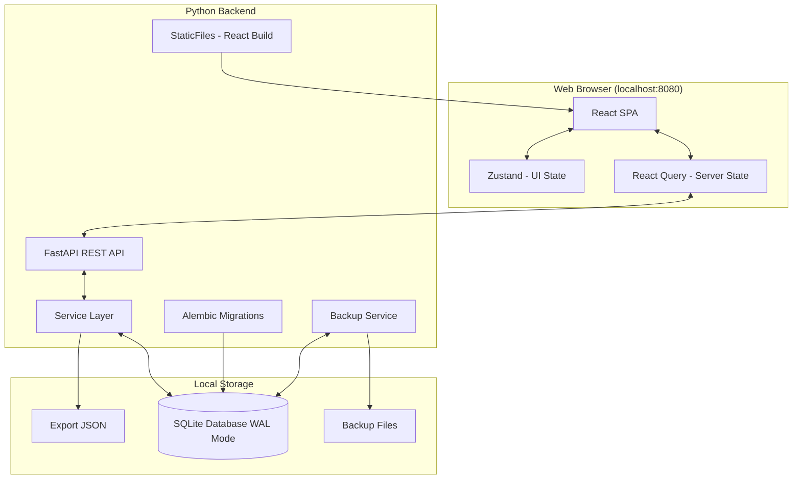
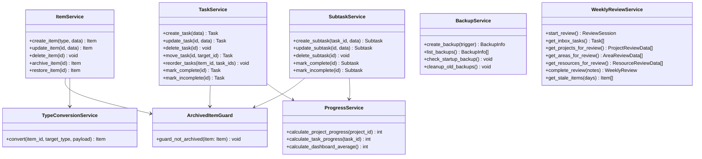
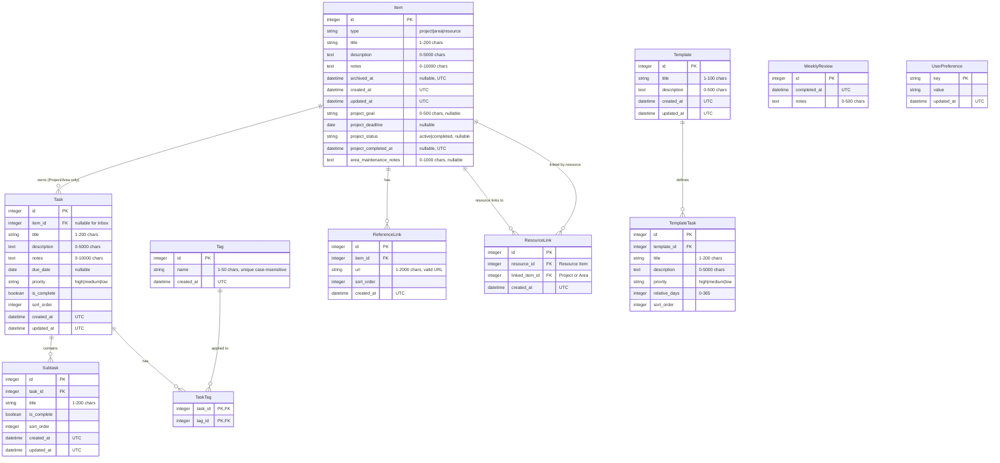
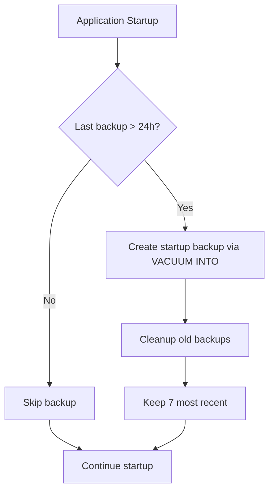

# Design Document: Calm-X PARA Task Manager

## Overview

Calm-X is a local task management web application implementing the PARA Method (Projects, Areas, Resources, Archives) from Tiago Forte's Second Brain methodology. The application runs on localhost (127.0.0.1:8080) with SQLite storage, providing a private, offline-capable productivity system.

This design document details the technical architecture, database schema, API design, and implementation strategies for building Calm-X according to the requirements specification.

### Key Design Principles

1. **Offline-First**: All functionality works without internet connectivity
2. **Data Integrity**: Type conversions preserve data; deletions require confirmation
3. **Single-User Simplicity**: No authentication overhead; direct SQLite access
4. **Responsive Performance**: Sub-100ms UI updates for status changes

## Architecture

### System Architecture Diagram



### Tech Stack Selection

#### Backend: FastAPI (Python 3.11+)

**Justification:**
- **Type Safety**: Native Python type hints with Pydantic models provide runtime validation matching the Field Constraints table
- **Performance**: Synchronous SQLAlchemy 2.0 provides excellent performance for local single-user app
- **SQLite Integration**: Python's built-in `sqlite3` module plus SQLAlchemy provides robust ORM support
- **Auto-Documentation**: OpenAPI/Swagger UI auto-generated for API testing
- **Single Binary**: Can be packaged with PyInstaller for simple distribution

**Key Dependencies:**
- `fastapi` (0.100+): Web framework
- `uvicorn`: ASGI server
- `sqlalchemy` (2.0+): Database ORM (synchronous)
- `pydantic` (2.0+): Request/response validation
- `pydantic-settings`: Configuration management
- `alembic`: Database migrations

#### Frontend: React 18 with TypeScript

**Justification:**
- **Component Reusability**: Dashboard cards, Item views, and Task lists share patterns
- **State Management**: Complex UI state (Weekly Review flow, drag-and-drop) benefits from React's model
- **TypeScript**: Type safety catches field constraint violations at compile time
- **Ecosystem**: @dnd-kit for drag-and-drop, react-query for API caching
- **768px+ Support**: CSS Grid/Flexbox with media queries handles responsive requirements

**Key Dependencies:**
- `react` (18+): UI framework
- `typescript` (5+): Type safety
- `zustand`: UI-only state (modals, sidebar, wizard steps)
- `@tanstack/react-query`: All server state and API caching
- `@dnd-kit/core`: Accessible drag-and-drop
- `react-router-dom`: Client-side routing
- `tailwindcss`: Utility-first CSS
- `date-fns`: Date manipulation (timezone-aware)
- `axios` or native `fetch`: HTTP client

#### Database: SQLite

**Justification (per requirements):**
- Local file-based storage for offline operation
- No server dependency for single-user application
- WAL mode for safe concurrent access
- JSON export/import maps directly to SQL queries

## Components and Interfaces

### Backend Service Architecture



### Frontend Component Hierarchy

```
App
├── Layout
│   ├── Sidebar (Navigation)
│   ├── Header (Quick Capture, Search, Settings)
│   └── MainContent
│       ├── Dashboard
│       │   ├── InboxCard
│       │   ├── ProjectsCard
│       │   ├── AreasCard
│       │   ├── ResourcesCard
│       │   ├── ArchivesCard
│       │   └── UpcomingDeadlines
│       ├── ItemListView (Projects/Areas/Resources)
│       │   ├── ItemCard
│       │   └── FilterPanel
│       ├── ItemDetailView
│       │   ├── ItemHeader
│       │   ├── TaskList (drag-and-drop)
│       │   ├── NotesEditor
│       │   └── ReferenceLinks
│       ├── InboxView
│       │   └── TaskList
│       ├── ArchiveView
│       │   ├── SearchBar
│       │   ├── FilterPanel
│       │   └── ArchivedItemList
│       ├── WeeklyReviewWizard
│       │   ├── InboxStep
│       │   ├── ProjectsStep
│       │   ├── AreasStep
│       │   ├── ResourcesStep
│       │   └── SummaryStep
│       ├── TemplateManager
│       └── SettingsView
└── Modals
    ├── CreateItemModal
    ├── ConfirmDeleteModal
    ├── TypeConversionModal
    └── ImportExportModal
```

### API Router Structure

```python
# api/
#   __init__.py
#   items.py      - CRUD for Projects, Areas, Resources
#   tasks.py      - Task management
#   subtasks.py   - Subtask management
#   tags.py       - Tag management
#   templates.py  - Template management
#   review.py     - Weekly review
#   search.py     - Global search
#   settings.py   - User preferences
#   backup.py     - Backup/export/import
#   dashboard.py  - Dashboard data
```

## UI/UX Design

The visual reference is the approved **Calm-X UI Prototype** (Design canvas with four artboards: Dashboard, Project detail + task drawer, Weekly review, Dashboard dark). Design tokens, components, interaction patterns, date formatting, shortcuts and accessibility rules are defined in `.kiro/steering/ui-guidelines.md` and are not repeated here. This section defines the screens, navigation and behavior.

**Decisions:** UI language English · light and dark themes in v1 · dates shown relative, absolute on hover.

### Information Architecture and Routes

| Route | Screen | Requirements |
|---|---|---|
| `/` | Dashboard (default landing page) | R1.1, R9.1–R9.4, R10.13, R14.5 |
| `/inbox` | Inbox | R3.1–R3.6 |
| `/projects` | Project list | R4, R9.5 |
| `/projects/:id` | Project detail + task drawer (`?task=:taskId`) | R4, R8, R14 |
| `/areas`, `/areas/:id` | Area list / detail | R5 |
| `/resources`, `/resources/:id` | Resource list / detail | R6 |
| `/archive` | Archive (search, filters, restore, delete) | R7 |
| `/templates` | Template manager | R11 |
| `/review` | Weekly review (focused mode, no sidebar) | R10 |
| `/settings` | Settings, theme, import/export, backups | R13.4–R13.6, R16 |

- The task drawer state lives in the URL (`?task=42`), so a drawer can be linked, survives refresh, and Back closes it.
- Global overlays available on every route: Quick capture (`Q`), command palette (`Ctrl/⌘+K`), shortcut help (`?`).

### App Shell

```
┌────────────┬──────────────────────────────────────────────────────┐
│ ◎ Calm-X   │ [🔍 Search projects, areas, resources, tasks…  /]     │
│            │                                [+ Quick capture  Q]  │
│ ▣ Dashboard├──────────────────────────────────────────────────────┤
│ ⇩ Inbox  4 │                                                      │
│ ◎ Projects │   Page content (max-width 1240px, padding 32px)      │
│ ⟳ Areas    │                                                      │
│ ▤ Resources│                                                      │
│ ▢ Archive  │                                                      │
│ ────────── │                                                      │
│ ▦ Templates│                                                      │
│ ☑ Review   │                                                      │
│ ⚙ Settings │                                                      │
└────────────┴──────────────────────────────────────────────────────┘
```

- Sidebar 232px at ≥1280px; collapses to a 64px icon rail at 768–1279px (labels become tooltips; the Inbox count stays visible as a dot/pill).
- Header search opens the command palette with results grouped by Projects, Areas, Resources, Tasks; archived results carry an "Archived" label (R9.6–R9.7).

### Screen: Dashboard

```
Dashboard                                         [☑ Start weekly review]
Monday, 26 October · Last weekly review 5 days ago

┌ Inbox ─────────┐ ┌ Projects ──────────┐ ┌ Areas ─────────────┐
│ 4 tasks to     │ │ 4 active projects  │ │ 6 areas            │
│ process        │ │ 18 open · nearest  │ │ 21 open tasks      │
│ Process inbox →│ │ deadline in 3 days │ │                    │
└────────────────┘ └────────────────────┘ └────────────────────┘
┌ Resources ─────┐ ┌ Archives ──────────┐ ┌ Overall progress ──┐
│ 12 resources   │ │ 31 archived items  │ │ 41%  ▓▓▓▓░░░░░░    │
│ 47 links       │ │                    │ │ across 4 projects  │
└────────────────┘ └────────────────────┘ └────────────────────┘
┌ Needs attention ─────────────────┐ ┌ Active projects ────────────────┐
│ ⚠ Overdue  Submit Q3 expense…  3d│ │ Kitchen renovation  ✓ Due in 25d│
│ ⚠ Overdue  Book electrician    1d│ │ ▓▓▓▓▓▓░░░░ 7/12 · 58%           │
│ ◷ Due soon Finalize tile…  Tmrw  │ │ Portfolio site      ◷ Due in 3d │
│ ◷ Due soon Portfolio site  3d    │ │ ▓▓▓▓▓▓▓▓░░ 8/10 · 80%           │
└──────────────────────────────────┘ └─────────────────────────────────┘
```

- Six cards in a 3-column grid (2 columns below 1280px); all five PARA/Inbox cards must be visible without scrolling at 1280×800 (R1.1).
- **Needs attention** lists incomplete tasks and active projects that are overdue (first, oldest first) or approaching within the threshold (soonest first). Data comes from `GET /api/dashboard?today=YYYY-MM-DD`.
- **Active projects** shows progress and deadline badge; projects without a deadline show "No deadline".
- Empty states: no projects → "Create your first project"; nothing needs attention → "Nothing overdue or due soon."

### Screen: Item Detail (Project / Area / Resource)

```
Dashboard / Projects / Portfolio site
Portfolio site  [Active] [◷ Due in 3 days]     [Mark project complete] [⋯]
Goal: Publish a portfolio with three case studies…

┌ Progress ─────────────────────── 80% · 8 of 10 tasks ┐   ┌ Task drawer ───────────┐
│ ▓▓▓▓▓▓▓▓▓▓▓▓▓▓▓▓░░░░                                 │   │ ☐ Draft case study #2  │
│ (✓ Ready for completion · [Complete project])        │   │ Project   Portfolio    │
└──────────────────────────────────────────────────────┘   │ Priority  High         │
┌ Tasks · 2 open ─────────────────────── [+ Add task] ┐   │ Due       ◷ In 2 days  │
│ ⠿ ☐ Draft case study #2     High · 2/4 · #writing ◷ │   │ Tags      #writing     │
│ ⠿ ☐ Compress hero images    Medium · #dev         ✓ │   │ Subtasks 2/4 ▓▓▓▓░░░░  │
│ › Show 8 completed                                  │   │ ☑ Outline  ☑ Screens   │
└─────────────────────────────────────────────────────┘   │ ☐ Draft    ☐ Feedback  │
┌ Notes ──────┐ ┌ Reference links ─┐ ┌ Linked resources ┐ │ Description …          │
└─────────────┘ └──────────────────┘ └──────────────────┘ │ [Move to…]  Delete task│
                                                          └────────────────────────┘
```

| Element | Project | Area | Resource |
|---|---|---|---|
| Header badges | Status (Active/Completed), deadline badge | — | — |
| Goal line | ✓ | — | — |
| Maintenance notes | — | ✓ | — |
| Progress card + "Ready for completion" | ✓ | — (task count only) | — |
| Task list (drag-and-drop, drawer) | ✓ | ✓ | — (R3.7) |
| Notes, reference links | ✓ | ✓ | ✓ |
| Linked resources / linked items | Linked resources | Linked resources | Linked Projects/Areas (R6.4) |
| "⋯" menu | Convert type, Archive, Delete | Convert type, Archive, Delete | Convert type, Archive, Delete |

- **Mark project complete** sets status only (R4.10) and then asks "Archive this project?" (R1.6). It does not complete the tasks.
- **Convert type** opens a dialog that names the consequences before confirming, e.g. "2 open tasks will move to the Inbox" (R2.2/R2.4) and "Links to 3 resources will be removed" (R2.8), with optional deadline/goal fields when converting to a Project (R2.3/R2.5).
- Completed tasks are grouped under a collapsible "Show N completed" row.
- Task limits: when an Item has 100 tasks, "Add task" is disabled with the R4.6/R5.5 message as its description.
- Archived Items open in the same layout with a "Read-only · Archived on {date}" banner (Restore, Delete permanently) and all editing controls disabled (R7.2, R7.10).

### Component: Task Drawer

- Opens from a task row (title click or Enter); width 400px at ≥1280px beside the list, overlay sheet below 1280px.
- Header checkbox follows the sync rules (R8.6–R8.10). Unchecking a completed task that has subtasks shows the confirmation "Reset all subtasks to incomplete?"; "Yes" calls `/incomplete` (R8.9), "No" keeps the task complete.
- Fields are edited inline: title, priority (select), due date (date picker with relative label), tags (combobox that can create a tag, max 20, R8.11/R12.1), description, notes.
- Subtasks: checklist with progress bar, "Add subtask" input (Enter adds, max 100), inline rename, delete with undo toast.
- Footer: "Move to…" (combobox listing non-archived Projects and Areas plus Inbox, R3.4–R3.5) and "Delete task" (undo toast).

### Screen: Inbox

- Same task row as item detail, plus a "Move to…" button on each row and a bulk-select checkbox (move several tasks at once).
- Quick capture input pinned at the top of the list (same behavior as the `Q` dialog).
- Empty state: "Inbox zero. Everything has a home."

### Screen: Archive

- Search field (title and description, R7.4), filters for type (Project/Area/Resource) and archived date range (R7.5), results sorted by archive date, newest first.
- Each row: type icon, title, "Archived {relative date}" (absolute on hover, R7.7), actions Restore and Delete (confirmation with the R7.10 message).

### Screen: Weekly Review

```
◎ Weekly review · Started today            Changes save as you go.  [✕ Exit review]
 (✓)Inbox ──── (2)Projects ──── (3)Areas ──── (4)Resources ──── (5)Summary

 Review active projects                                   Project 1 of 4
 ┌──────────────────────────────────────────────────────────────────────┐
 │ Kitchen renovation              7/12 tasks done · Updated yesterday  │
 │ ▓▓▓▓▓▓▓▓▓▓░░░░░░░                                                    │
 │ Book electrician      Overdue · Yesterday  [Keep][Update due][✓][✕] │
 │ Finalize tiles        Due soon · Tomorrow  [Keep][Update due][✓][✕] │
 │ [Mark project complete] [Archive project]      ← Previous  Next →    │
 └──────────────────────────────────────────────────────────────────────┘
 [← Back]                                                  [Next: Areas →]
```

| Step | Content | Actions |
|---|---|---|
| Inbox | One task at a time, "Task n of N" progress | Move to project (select), Move to area (select), Mark complete, Delete, Skip (R10.3) |
| Projects | One active project at a time: done/total, progress, "Updated …", open tasks | Per task: Keep, Update due date, Complete, Delete (R10.5); per project: Mark complete, Archive; stale banner after 30 days without updates (R10.8) |
| Areas | All areas: open count, next task, overdue badge | "Looks good" toggle, "+ Add task" (R10.6) |
| Resources | Least recently updated first; stale ones flagged "Suggest archiving" | Keep, Update, Archive (R10.7–R10.8) |
| Summary | Counts of what changed, notes textarea (max 500, live counter) | Complete review (R10.10–R10.11) |

- Every action is saved immediately (R10.9). "Exit review" returns to the Dashboard without recording a review (R10.12); the header states this.
- The completion screen confirms the recorded date and links back to the Dashboard; the Dashboard then shows "Last weekly review today".

### Screen: Templates

- List of templates (title, description, number of tasks). Editor: title, description, task list with relative day offset ("Day 0 … Day 365"), priority, reorder by drag (R11.1–R11.2).
- "New project" offers "Start from template" or "Blank project" (R11.4). From a template: editable title (prefilled), start date (default today), live preview of calculated due dates (R11.3).
- Validation errors stay inline and keep the entered data (R11.5).

### Screen: Settings

- **Appearance:** theme (System / Light / Dark).
- **Deadlines:** Approaching_Deadline_Threshold, number input 1–30 days with live preview text "Tasks due within 3 days are marked as due soon" (R16.2–R16.3).
- **Data:** Export JSON (R13.4); Import JSON with Merge / Replace choice, file summary before confirming, replace requires confirmation and states that a backup is created first (R13.5); backup list with dates and sizes, "Create backup now" (R13.6).

### Global Overlays

- **Quick capture** (`Q` or header button): dialog with a single title field, Enter saves to Inbox with Medium priority (R3.2–R3.3), toast "Added to Inbox" with a link to the Inbox.
- **Command palette** (`Ctrl/⌘+K` or focusing search): groups Navigation, Actions (New project, Quick capture, Start weekly review), and search results across Items and Tasks.
- **Shortcut help** (`?`): dialog listing every shortcut from the steering file.

### Screen States

| State | Behavior |
|---|---|
| Loading | Skeletons that match the final layout, shown after 200 ms (R15.5) |
| Empty | `EmptyState` with one sentence and the next action |
| Error (load) | Inline error panel with "Try again"; the rest of the page stays usable |
| Error (save) | Optimistic change rolled back + error toast (R13.8) |
| Read-only (archived) | Banner + disabled controls (R7.2) |
| Validation | Inline message under the field, using the server's `fields` map |

### Frontend Additions to the Component Hierarchy

In addition to the hierarchy above:
- `components/common/`: `Button`, `StatusBadge`, `RelativeDate`, `ProgressBar`, `Card`, `EmptyState`, `ConfirmDialog`, `Kbd`, `PriorityChip`, `TagChip`, `Skeleton`.
- `components/tasks/`: `TaskRow`, `TaskDrawer`, `SubtaskList`, `MoveToCombobox`.
- `components/layout/`: `AppShell`, `Sidebar` (full + rail), `Header`, `ThemeProvider`.
- `components/overlays/`: `QuickCaptureDialog`, `CommandPalette`, `ShortcutHelp`.
- `hooks/`: `useShortcuts` (ignores events from inputs), `useLocalToday`, `useOptimisticToggle`.

### Requirement Updates Needed

These UI decisions need matching acceptance criteria in requirements.md:
1. **Theme preference (R16):** "THE Calm_X_App SHALL allow the user to choose a theme (System, Light, Dark), apply it immediately, and persist it in the SQLite_Database."
2. **Relative dates (R8/R9):** "THE Calm_X_App SHALL display dates relative to the user's local date and show the absolute date (e.g. 'Thu, 29 Oct 2026') on hover and focus."
3. **Keyboard shortcuts (R15.7):** extend with Q (quick capture), / (search), Ctrl/⌘+K (command palette), ? (shortcut help), Escape (close overlays).

## Data Models

### Entity Relationship Diagram



### UTCDateTime TypeDecorator

A custom SQLAlchemy TypeDecorator ensures consistent UTC datetime handling:

```python
# backend/models/types.py
from sqlalchemy import TypeDecorator, DateTime
from datetime import datetime, timezone

class UTCDateTime(TypeDecorator):
    """TypeDecorator that stores datetime as naive UTC in SQLite
    and returns timezone-aware datetime when loaded."""
    
    impl = DateTime
    cache_ok = True
    
    def process_bind_param(self, value, dialect):
        """Convert timezone-aware datetime to naive UTC for storage."""
        if value is not None:
            if value.tzinfo is not None:
                value = value.astimezone(timezone.utc).replace(tzinfo=None)
        return value
    
    def process_result_value(self, value, dialect):
        """Return timezone-aware UTC datetime when loading from database."""
        if value is not None:
            return value.replace(tzinfo=timezone.utc)
        return value
```

All timestamp columns use `UTCDateTime` type, and timestamps are set from Python code (not SQL defaults).

### SQLite Schema DDL

```sql
-- Schema managed by Alembic migrations
-- WAL mode and foreign keys enabled via SQLAlchemy event listener
-- NOTE: All timestamps are set from Python code using UTCDateTime TypeDecorator
-- No SQL DEFAULT clauses for datetime columns

-- Items table (Projects, Areas, Resources)
CREATE TABLE items (
    id INTEGER PRIMARY KEY AUTOINCREMENT,
    type TEXT NOT NULL CHECK (type IN ('project', 'area', 'resource')),
    title TEXT NOT NULL CHECK (length(trim(title)) >= 1 AND length(title) <= 200),
    description TEXT DEFAULT '' CHECK (length(description) <= 5000),
    notes TEXT DEFAULT '' CHECK (length(notes) <= 10000),
    archived_at DATETIME DEFAULT NULL,
    created_at DATETIME NOT NULL,
    updated_at DATETIME NOT NULL,
    
    -- Project-specific fields (nullable, hidden for other types)
    project_goal TEXT DEFAULT NULL CHECK (project_goal IS NULL OR length(project_goal) <= 500),
    project_deadline DATE DEFAULT NULL,
    project_status TEXT DEFAULT NULL CHECK (project_status IS NULL OR project_status IN ('active', 'completed')),
    project_completed_at DATETIME DEFAULT NULL,
    
    -- Area-specific fields (nullable, hidden for other types)
    area_maintenance_notes TEXT DEFAULT NULL CHECK (area_maintenance_notes IS NULL OR length(area_maintenance_notes) <= 1000)
);

-- Tasks table
CREATE TABLE tasks (
    id INTEGER PRIMARY KEY AUTOINCREMENT,
    item_id INTEGER DEFAULT NULL,
    title TEXT NOT NULL CHECK (length(trim(title)) >= 1 AND length(title) <= 200),
    description TEXT DEFAULT '' CHECK (length(description) <= 5000),
    notes TEXT DEFAULT '' CHECK (length(notes) <= 10000),
    due_date DATE DEFAULT NULL,
    priority TEXT NOT NULL DEFAULT 'medium' CHECK (priority IN ('high', 'medium', 'low')),
    is_complete INTEGER NOT NULL DEFAULT 0 CHECK (is_complete IN (0, 1)),
    sort_order INTEGER NOT NULL DEFAULT 0,
    created_at DATETIME NOT NULL,
    updated_at DATETIME NOT NULL,
    
    FOREIGN KEY (item_id) REFERENCES items(id) ON DELETE CASCADE
);

-- Subtasks table
CREATE TABLE subtasks (
    id INTEGER PRIMARY KEY AUTOINCREMENT,
    task_id INTEGER NOT NULL,
    title TEXT NOT NULL CHECK (length(trim(title)) >= 1 AND length(title) <= 200),
    is_complete INTEGER NOT NULL DEFAULT 0 CHECK (is_complete IN (0, 1)),
    sort_order INTEGER NOT NULL DEFAULT 0,
    created_at DATETIME NOT NULL,
    updated_at DATETIME NOT NULL,
    
    FOREIGN KEY (task_id) REFERENCES tasks(id) ON DELETE CASCADE
);

-- Tags table (case-insensitive uniqueness via COLLATE NOCASE)
CREATE TABLE tags (
    id INTEGER PRIMARY KEY AUTOINCREMENT,
    name TEXT NOT NULL UNIQUE COLLATE NOCASE CHECK (length(trim(name)) >= 1 AND length(name) <= 50),
    created_at DATETIME NOT NULL
);

-- Task-Tag junction table
CREATE TABLE task_tags (
    task_id INTEGER NOT NULL,
    tag_id INTEGER NOT NULL,
    
    PRIMARY KEY (task_id, tag_id),
    FOREIGN KEY (task_id) REFERENCES tasks(id) ON DELETE CASCADE,
    FOREIGN KEY (tag_id) REFERENCES tags(id) ON DELETE CASCADE
);

-- Reference links for Items (max 50 per item enforced in service layer)
CREATE TABLE reference_links (
    id INTEGER PRIMARY KEY AUTOINCREMENT,
    item_id INTEGER NOT NULL,
    url TEXT NOT NULL CHECK (length(url) >= 1 AND length(url) <= 2000),
    sort_order INTEGER NOT NULL DEFAULT 0,
    created_at DATETIME NOT NULL,
    
    FOREIGN KEY (item_id) REFERENCES items(id) ON DELETE CASCADE
);

-- Resource-to-Item links (max 20 per resource enforced in service layer)
CREATE TABLE resource_links (
    id INTEGER PRIMARY KEY AUTOINCREMENT,
    resource_id INTEGER NOT NULL,
    linked_item_id INTEGER NOT NULL,
    created_at DATETIME NOT NULL,
    
    FOREIGN KEY (resource_id) REFERENCES items(id) ON DELETE CASCADE,
    FOREIGN KEY (linked_item_id) REFERENCES items(id) ON DELETE CASCADE,
    UNIQUE (resource_id, linked_item_id)
);

-- Templates table
CREATE TABLE templates (
    id INTEGER PRIMARY KEY AUTOINCREMENT,
    title TEXT NOT NULL CHECK (length(trim(title)) >= 1 AND length(title) <= 100),
    description TEXT DEFAULT '' CHECK (length(description) <= 500),
    created_at DATETIME NOT NULL,
    updated_at DATETIME NOT NULL
);

-- Template tasks (max 50 per template enforced in service layer)
CREATE TABLE template_tasks (
    id INTEGER PRIMARY KEY AUTOINCREMENT,
    template_id INTEGER NOT NULL,
    title TEXT NOT NULL CHECK (length(trim(title)) >= 1 AND length(title) <= 200),
    description TEXT DEFAULT '' CHECK (length(description) <= 5000),
    priority TEXT NOT NULL DEFAULT 'medium' CHECK (priority IN ('high', 'medium', 'low')),
    relative_days INTEGER NOT NULL DEFAULT 0 CHECK (relative_days >= 0 AND relative_days <= 365),
    sort_order INTEGER NOT NULL DEFAULT 0,
    
    FOREIGN KEY (template_id) REFERENCES templates(id) ON DELETE CASCADE
);

-- Weekly review history
CREATE TABLE weekly_reviews (
    id INTEGER PRIMARY KEY AUTOINCREMENT,
    completed_at DATETIME NOT NULL,
    notes TEXT DEFAULT '' CHECK (length(notes) <= 500)
);

-- User preferences (key-value store)
CREATE TABLE user_preferences (
    key TEXT PRIMARY KEY,
    value TEXT NOT NULL,
    updated_at DATETIME NOT NULL
);

-- Indexes for performance
CREATE INDEX idx_items_type ON items(type);
CREATE INDEX idx_items_archived_at ON items(archived_at);
CREATE INDEX idx_items_updated_at ON items(updated_at);
CREATE INDEX idx_tasks_item_id ON tasks(item_id);
CREATE INDEX idx_tasks_due_date ON tasks(due_date);
CREATE INDEX idx_tasks_priority ON tasks(priority);
CREATE INDEX idx_tasks_is_complete ON tasks(is_complete);
CREATE INDEX idx_subtasks_task_id ON subtasks(task_id);
CREATE INDEX idx_reference_links_item_id ON reference_links(item_id);
CREATE INDEX idx_resource_links_resource_id ON resource_links(resource_id);
CREATE INDEX idx_resource_links_linked_item_id ON resource_links(linked_item_id);
CREATE INDEX idx_template_tasks_template_id ON template_tasks(template_id);

-- Insert default preferences (timestamps set from Python during migration)
-- INSERT INTO user_preferences (key, value, updated_at) VALUES ('approaching_deadline_threshold', '3', <python_timestamp>);
```

### ORM Models with Relationships

SQLAlchemy ORM models with proper cascade configuration:

```python
# backend/models/item.py
from sqlalchemy import Column, Integer, String, Text, Date, DateTime, ForeignKey, CheckConstraint
from sqlalchemy.orm import relationship
from backend.models.base import Base
from backend.models.types import UTCDateTime

class Item(Base):
    __tablename__ = "items"
    
    id = Column(Integer, primary_key=True, autoincrement=True)
    type = Column(String, nullable=False)
    title = Column(String(200), nullable=False)
    description = Column(Text, default="")
    notes = Column(Text, default="")
    archived_at = Column(UTCDateTime, nullable=True)
    created_at = Column(UTCDateTime, nullable=False)
    updated_at = Column(UTCDateTime, nullable=False)
    
    # Project-specific fields
    project_goal = Column(String(500), nullable=True)
    project_deadline = Column(Date, nullable=True)
    project_status = Column(String, nullable=True)
    project_completed_at = Column(UTCDateTime, nullable=True)
    
    # Area-specific fields
    area_maintenance_notes = Column(String(1000), nullable=True)
    
    # Relationships with proper cascade (delete-orphan + passive_deletes for DB cascade)
    tasks = relationship(
        "Task", 
        back_populates="item",
        cascade="all, delete-orphan",
        passive_deletes=True
    )
    reference_links = relationship(
        "ReferenceLink",
        back_populates="item",
        cascade="all, delete-orphan",
        passive_deletes=True
    )
    # ResourceLink relationships (both directions)
    resource_links_as_resource = relationship(
        "ResourceLink",
        foreign_keys="ResourceLink.resource_id",
        back_populates="resource",
        cascade="all, delete-orphan",
        passive_deletes=True
    )
    resource_links_as_linked = relationship(
        "ResourceLink",
        foreign_keys="ResourceLink.linked_item_id",
        back_populates="linked_item",
        cascade="all, delete-orphan",
        passive_deletes=True
    )


class Task(Base):
    __tablename__ = "tasks"
    
    id = Column(Integer, primary_key=True, autoincrement=True)
    item_id = Column(Integer, ForeignKey("items.id", ondelete="CASCADE"), nullable=True)
    title = Column(String(200), nullable=False)
    description = Column(Text, default="")
    notes = Column(Text, default="")
    due_date = Column(Date, nullable=True)
    priority = Column(String, nullable=False, default="medium")
    is_complete = Column(Integer, nullable=False, default=0)
    sort_order = Column(Integer, nullable=False, default=0)
    created_at = Column(UTCDateTime, nullable=False)
    updated_at = Column(UTCDateTime, nullable=False)
    
    # Relationships
    item = relationship("Item", back_populates="tasks")
    subtasks = relationship(
        "Subtask",
        back_populates="task",
        cascade="all, delete-orphan",
        passive_deletes=True
    )
    task_tags = relationship(
        "TaskTag",
        back_populates="task",
        cascade="all, delete-orphan",
        passive_deletes=True
    )


class Subtask(Base):
    __tablename__ = "subtasks"
    
    id = Column(Integer, primary_key=True, autoincrement=True)
    task_id = Column(Integer, ForeignKey("tasks.id", ondelete="CASCADE"), nullable=False)
    title = Column(String(200), nullable=False)
    is_complete = Column(Integer, nullable=False, default=0)
    sort_order = Column(Integer, nullable=False, default=0)
    created_at = Column(UTCDateTime, nullable=False)
    updated_at = Column(UTCDateTime, nullable=False)
    
    # Relationships
    task = relationship("Task", back_populates="subtasks")


class Template(Base):
    __tablename__ = "templates"
    
    id = Column(Integer, primary_key=True, autoincrement=True)
    title = Column(String(100), nullable=False)
    description = Column(Text, default="")
    created_at = Column(UTCDateTime, nullable=False)
    updated_at = Column(UTCDateTime, nullable=False)
    
    # Relationships
    template_tasks = relationship(
        "TemplateTask",
        back_populates="template",
        cascade="all, delete-orphan",
        passive_deletes=True
    )


class TemplateTask(Base):
    __tablename__ = "template_tasks"
    
    id = Column(Integer, primary_key=True, autoincrement=True)
    template_id = Column(Integer, ForeignKey("templates.id", ondelete="CASCADE"), nullable=False)
    title = Column(String(200), nullable=False)
    description = Column(Text, default="")
    priority = Column(String, nullable=False, default="medium")
    relative_days = Column(Integer, nullable=False, default=0)
    sort_order = Column(Integer, nullable=False, default=0)
    
    # Relationships
    template = relationship("Template", back_populates="template_tasks")


class ReferenceLink(Base):
    __tablename__ = "reference_links"
    
    id = Column(Integer, primary_key=True, autoincrement=True)
    item_id = Column(Integer, ForeignKey("items.id", ondelete="CASCADE"), nullable=False)
    url = Column(String(2000), nullable=False)
    sort_order = Column(Integer, nullable=False, default=0)
    created_at = Column(UTCDateTime, nullable=False)
    
    # Relationships
    item = relationship("Item", back_populates="reference_links")


class ResourceLink(Base):
    __tablename__ = "resource_links"
    
    id = Column(Integer, primary_key=True, autoincrement=True)
    resource_id = Column(Integer, ForeignKey("items.id", ondelete="CASCADE"), nullable=False)
    linked_item_id = Column(Integer, ForeignKey("items.id", ondelete="CASCADE"), nullable=False)
    created_at = Column(UTCDateTime, nullable=False)
    
    # Relationships
    resource = relationship("Item", foreign_keys=[resource_id], back_populates="resource_links_as_resource")
    linked_item = relationship("Item", foreign_keys=[linked_item_id], back_populates="resource_links_as_linked")


class TaskTag(Base):
    __tablename__ = "task_tags"
    
    task_id = Column(Integer, ForeignKey("tasks.id", ondelete="CASCADE"), primary_key=True)
    tag_id = Column(Integer, ForeignKey("tags.id", ondelete="CASCADE"), primary_key=True)
    
    # Relationships
    task = relationship("Task", back_populates="task_tags")
    tag = relationship("Tag", back_populates="task_tags")


class Tag(Base):
    __tablename__ = "tags"
    
    id = Column(Integer, primary_key=True, autoincrement=True)
    name = Column(String(50), nullable=False, unique=True)
    created_at = Column(UTCDateTime, nullable=False)
    
    # Relationships
    task_tags = relationship(
        "TaskTag",
        back_populates="tag",
        cascade="all, delete-orphan",
        passive_deletes=True
    )
```

### SQLite PRAGMA Configuration

Enable foreign keys and WAL mode for every connection via SQLAlchemy event listener:

```python
# backend/database.py
from sqlalchemy import create_engine, event, text
from sqlalchemy.orm import Session, sessionmaker
from sqlalchemy.engine import Engine
from contextlib import contextmanager
from backend.config import Config

@event.listens_for(Engine, "connect")
def set_sqlite_pragma(dbapi_connection, connection_record):
    cursor = dbapi_connection.cursor()
    cursor.execute("PRAGMA foreign_keys=ON")
    cursor.execute("PRAGMA journal_mode=WAL")
    cursor.close()

def create_db_engine(config: Config):
    return create_engine(f"sqlite:///{config.absolute_db_path}")

@contextmanager
def get_session(engine):
    """Context manager for database sessions with automatic rollback on error."""
    SessionLocal = sessionmaker(bind=engine)
    session = SessionLocal()
    try:
        yield session
        session.commit()
    except Exception:
        session.rollback()
        raise
    finally:
        session.close()
```

### Pydantic Models (Backend)

```python
# backend/schemas/item.py
from pydantic import BaseModel, Field, field_validator
from datetime import date, datetime, timezone
from typing import Optional, Literal
from enum import Enum
import re

class ItemType(str, Enum):
    PROJECT = "project"
    AREA = "area"
    RESOURCE = "resource"

class Priority(str, Enum):
    HIGH = "high"
    MEDIUM = "medium"
    LOW = "low"

class ProjectStatus(str, Enum):
    ACTIVE = "active"
    COMPLETED = "completed"

# Base schemas with validation
class ItemBase(BaseModel):
    title: str = Field(..., min_length=1, max_length=200)
    description: str = Field(default="", max_length=5000)
    notes: str = Field(default="", max_length=10000)
    
    @field_validator('title', mode='before')
    @classmethod
    def strip_title(cls, v):
        return v.strip() if isinstance(v, str) else v

class ItemCreate(ItemBase):
    type: ItemType
    project_goal: Optional[str] = Field(default=None, max_length=500)
    project_deadline: Optional[date] = None
    area_maintenance_notes: Optional[str] = Field(default=None, max_length=1000)

class TypeConversionPayload(BaseModel):
    """Optional fields when converting to a type."""
    target_type: ItemType
    project_goal: Optional[str] = Field(default=None, max_length=500)
    project_deadline: Optional[date] = None
    area_maintenance_notes: Optional[str] = Field(default=None, max_length=1000)

# Type-specific response schemas (only include relevant fields)
class ProjectResponse(ItemBase):
    id: int
    type: Literal["project"]
    archived_at: Optional[datetime]
    created_at: datetime
    updated_at: datetime
    project_goal: Optional[str]
    project_deadline: Optional[date]
    project_status: ProjectStatus
    project_completed_at: Optional[datetime]
    task_count: int = 0
    completed_task_count: int = 0
    progress_percentage: int = 0

class AreaResponse(ItemBase):
    id: int
    type: Literal["area"]
    archived_at: Optional[datetime]
    created_at: datetime
    updated_at: datetime
    area_maintenance_notes: Optional[str]
    task_count: int = 0
    completed_task_count: int = 0

class ResourceResponse(ItemBase):
    id: int
    type: Literal["resource"]
    archived_at: Optional[datetime]
    created_at: datetime
    updated_at: datetime
    reference_link_count: int = 0
    linked_item_count: int = 0

class TaskCreate(BaseModel):
    title: str = Field(..., min_length=1, max_length=200)
    description: str = Field(default="", max_length=5000)
    notes: str = Field(default="", max_length=10000)
    due_date: Optional[date] = None
    priority: Priority = Priority.MEDIUM
    tag_ids: list[int] = Field(default_factory=list, max_length=20)
    
    @field_validator('title', mode='before')
    @classmethod
    def strip_title(cls, v):
        return v.strip() if isinstance(v, str) else v
    
    @field_validator('tag_ids')
    @classmethod
    def validate_tag_count(cls, v):
        if len(v) > 20:
            raise ValueError("Maximum 20 tags per task")
        return v

class TaskResponse(BaseModel):
    id: int
    item_id: Optional[int]
    title: str
    description: str
    notes: str
    due_date: Optional[date]
    priority: Priority
    is_complete: bool
    sort_order: int
    created_at: datetime
    updated_at: datetime
    tags: list["TagResponse"] = []
    subtasks: list["SubtaskResponse"] = []
    progress_percentage: int = 0
    # Deadline status calculated by frontend using local date

class SubtaskCreate(BaseModel):
    title: str = Field(..., min_length=1, max_length=200)
    
    @field_validator('title', mode='before')
    @classmethod
    def strip_title(cls, v):
        return v.strip() if isinstance(v, str) else v

class SubtaskResponse(BaseModel):
    id: int
    task_id: int
    title: str
    is_complete: bool
    sort_order: int

class TagResponse(BaseModel):
    id: int
    name: str

class ReferenceLinkCreate(BaseModel):
    """Reference link creation with URL validation (no normalization)."""
    url: str = Field(..., max_length=2000)
    
    @field_validator('url')
    @classmethod
    def validate_url(cls, v: str) -> str:
        """Validate http/https URL without normalization."""
        pattern = r'^https?://[^\s]+$'
        if not re.match(pattern, v):
            raise ValueError('URL must start with http:// or https://')
        if len(v) > 2000:
            raise ValueError('URL must be at most 2000 characters')
        return v  # Return as-is, no normalization

class ReferenceLinkResponse(BaseModel):
    id: int
    item_id: int
    url: str
    sort_order: int
```

### TypeScript Interfaces (Frontend)

```typescript
// types/models.ts
export type ItemType = 'project' | 'area' | 'resource';
export type Priority = 'high' | 'medium' | 'low';
export type ProjectStatus = 'active' | 'completed';
export type DeadlineStatus = 'overdue' | 'approaching' | 'on-track';

export interface Project {
  id: number;
  type: 'project';
  title: string;
  description: string;
  notes: string;
  archivedAt: string | null;
  createdAt: string;
  updatedAt: string;
  projectGoal: string | null;
  projectDeadline: string | null;
  projectStatus: ProjectStatus;
  projectCompletedAt: string | null;
  taskCount: number;
  completedTaskCount: number;
  progressPercentage: number;
}

export interface Area {
  id: number;
  type: 'area';
  title: string;
  description: string;
  notes: string;
  archivedAt: string | null;
  createdAt: string;
  updatedAt: string;
  areaMaintenanceNotes: string | null;
  taskCount: number;
  completedTaskCount: number;
}

export interface Resource {
  id: number;
  type: 'resource';
  title: string;
  description: string;
  notes: string;
  archivedAt: string | null;
  createdAt: string;
  updatedAt: string;
  referenceLinkCount: number;
  linkedItemCount: number;
}

export type Item = Project | Area | Resource;

export interface Task {
  id: number;
  itemId: number | null;
  title: string;
  description: string;
  notes: string;
  dueDate: string | null;  // ISO date string
  priority: Priority;
  isComplete: boolean;
  sortOrder: number;
  createdAt: string;
  updatedAt: string;
  tags: Tag[];
  subtasks: Subtask[];
  progressPercentage: number;
}

export interface Subtask {
  id: number;
  taskId: number;
  title: string;
  isComplete: boolean;
  sortOrder: number;
}

export interface Tag {
  id: number;
  name: string;
}

export interface Template {
  id: number;
  title: string;
  description: string;
  tasks: TemplateTask[];
}

export interface TemplateTask {
  id: number;
  title: string;
  description: string;
  priority: Priority;
  relativeDays: number;
  sortOrder: number;
}

export interface WeeklyReview {
  id: number;
  completedAt: string;
  notes: string;
}

export interface DashboardData {
  inboxCount: number;
  activeProjectsCount: number;
  activeTaskCount: number;
  nearestDeadline: string | null;
  areasCount: number;
  areaTaskCount: number;
  resourcesCount: number;
  referenceLinkCount: number;
  archivesCount: number;
  overallProgress: number;
  upcomingDeadlines: DeadlineItem[];
  lastReviewDate: string | null;
}

// Deadline status calculation (frontend)
export function getDeadlineStatus(
  dueDate: string | null,
  isComplete: boolean,
  threshold: number,
  localToday: string  // YYYY-MM-DD in client timezone
): DeadlineStatus | null {
  if (!dueDate || isComplete) return null;
  
  const due = new Date(dueDate + 'T00:00:00');
  const today = new Date(localToday + 'T00:00:00');
  const diffDays = Math.floor((due.getTime() - today.getTime()) / (1000 * 60 * 60 * 24));
  
  if (diffDays < 0) return 'overdue';
  if (diffDays <= threshold) return 'approaching';
  return 'on-track';
}

// Progress calculation with correct rounding
export function calculateProgress(completed: number, total: number): number {
  if (total === 0) return 0;
  // Formula: (200*m + n) // (2*n) handles .5 rounding correctly
  return Math.floor((200 * completed + total) / (2 * total));
}
```

## API Endpoints

### Items (Projects, Areas, Resources)

| Method | Path | Description | Req. Reference |
|--------|------|-------------|----------------|
| GET | `/api/items` | List all items (filterable by type, archived status) | R1.1, R7.3 |
| GET | `/api/items/{id}` | Get item details with tasks and links | R1.3 |
| POST | `/api/items` | Create new item | R1.2, R1.3, R4.1, R5.1, R6.1 |
| PUT | `/api/items/{id}` | Update item | R1.3 |
| DELETE | `/api/items/{id}` | Delete item (works for active and archived) | R1.3, R1.4, R2.9, R7.9 |
| POST | `/api/items/{id}/convert` | Convert item type | R1.5, R2.1-R2.8 |
| POST | `/api/items/{id}/archive` | Archive item | R7.1 |
| POST | `/api/items/{id}/restore` | Restore archived item | R7.6 |
| POST | `/api/items/{id}/complete` | Mark project as completed | R4.10 |
| POST | `/api/items/{id}/reopen` | Reopen completed project | R4.11 |

### Tasks

| Method | Path | Description | Req. Reference |
|--------|------|-------------|----------------|
| GET | `/api/tasks` | List tasks with filters | R12.5-R12.9 |
| GET | `/api/tasks/inbox` | Get inbox tasks | R3.1 |
| GET | `/api/items/{id}/tasks` | Get tasks for an item | R4.5, R5.4 |
| POST | `/api/tasks` | Create task | R8.1 |
| POST | `/api/tasks/quick-capture` | Quick capture to inbox | R3.2, R3.3 |
| PUT | `/api/tasks/{id}` | Update task | R8.1 |
| DELETE | `/api/tasks/{id}` | Delete task | R8.1 |
| POST | `/api/tasks/{id}/move` | Move task to item/inbox | R3.4, R3.5, R3.8 |
| POST | `/api/tasks/{id}/complete` | Mark task complete | R8.8 |
| POST | `/api/tasks/{id}/incomplete` | Mark task incomplete | R8.9 |
| PUT | `/api/items/{id}/tasks/reorder` | Reorder tasks | R4.9, R5.7 |

### Filter Endpoint Query Parameters

```
GET /api/tasks?tags=1,2,3&priorities=high,medium&due_start=2024-01-01&due_end=2024-01-31&category=project&item_id=5&include_archived=false
```

Parameters:
- `tags`: Comma-separated tag IDs (OR logic within tags)
- `priorities`: Comma-separated priority levels (OR logic within priorities)
- `due_start`: Start of due date range (inclusive)
- `due_end`: End of due date range (inclusive)
- `category`: Filter by item type (project|area|inbox)
- `item_id`: Filter by specific item
- `include_archived`: Include tasks from archived items (default: false)

All filter types combined use AND logic.

### Subtasks

| Method | Path | Description | Req. Reference |
|--------|------|-------------|----------------|
| GET | `/api/tasks/{id}/subtasks` | Get subtasks for a task | R8.3 |
| POST | `/api/tasks/{id}/subtasks` | Create subtask | R8.3, R8.10 |
| PUT | `/api/subtasks/{id}` | Update subtask | R8.4 |
| DELETE | `/api/subtasks/{id}` | Delete subtask | R8.4 |
| POST | `/api/subtasks/{id}/complete` | Mark subtask complete | R8.4, R8.6 |
| POST | `/api/subtasks/{id}/incomplete` | Mark subtask incomplete | R8.7 |

### Tags

| Method | Path | Description | Req. Reference |
|--------|------|-------------|----------------|
| GET | `/api/tags` | List all tags | R12.1 |
| POST | `/api/tags` | Create tag | R12.1 |
| PUT | `/api/tags/{id}` | Rename tag | R12.1 |
| DELETE | `/api/tags/{id}` | Delete tag | R12.1, R12.4 |

### Templates

| Method | Path | Description | Req. Reference |
|--------|------|-------------|----------------|
| GET | `/api/templates` | List all templates | R11.1 |
| GET | `/api/templates/{id}` | Get template with tasks | R11.1 |
| POST | `/api/templates` | Create template | R11.1 |
| PUT | `/api/templates/{id}` | Update template | R11.1 |
| DELETE | `/api/templates/{id}` | Delete template | R11.1 |
| POST | `/api/templates/{id}/create-project` | Create project from template | R11.3 |

### Create Project from Template Payload

```json
{
  "template_id": 1,
  "title": "My Project",
  "start_date": "2024-01-15",
  "project_goal": "...",
  "project_deadline": "2024-03-15"
}
```

- `title`: Optional, defaults to template title
- `start_date`: Optional, defaults to today; used to calculate task due dates from relative_days
- `project_goal`: Optional
- `project_deadline`: Optional

### Weekly Review

| Method | Path | Description | Req. Reference |
|--------|------|-------------|----------------|
| GET | `/api/weekly-review/status` | Get current review status | R10.13 |
| POST | `/api/weekly-review/start` | Start new review session | R10.1, R10.2 |
| GET | `/api/weekly-review/inbox` | Get inbox items for review | R10.3 |
| GET | `/api/weekly-review/projects` | Get projects for review | R10.4, R10.5 |
| GET | `/api/weekly-review/areas` | Get areas for review | R10.6 |
| GET | `/api/weekly-review/resources` | Get resources for review | R10.7 |
| GET | `/api/weekly-review/stale-items` | Get items with no updates for 30+ days | R10.8 |
| POST | `/api/weekly-review/complete` | Complete review with notes | R10.10, R10.11 |
| GET | `/api/weekly-review/history` | List past reviews | R10.13 |

### Dashboard and Search

| Method | Path | Description | Req. Reference |
|--------|------|-------------|----------------|
| GET | `/api/dashboard` | Get dashboard summary data | R9.1, R9.2, R9.3, R9.4 |
| GET | `/api/search?q={query}` | Global search across items and tasks | R9.6, R9.7 |

#### Dashboard Query Parameter

```
GET /api/dashboard?today=2024-01-15
```

Parameters:
- `today`: Client's local date in YYYY-MM-DD format for deadline calculations. Defaults to server's date if not provided.

### Settings

| Method | Path | Description | Req. Reference |
|--------|------|-------------|----------------|
| GET | `/api/settings` | Get all user preferences | R16.1 |
| PUT | `/api/settings` | Update user preferences | R16.2, R16.3 |

### Backup and Data Management

| Method | Path | Description | Req. Reference |
|--------|------|-------------|----------------|
| GET | `/api/backup/list` | List available backups | R13.6 |
| POST | `/api/backup/create` | Create manual backup | R13.6 |
| GET | `/api/export` | Export all data as JSON | R13.4 |
| POST | `/api/import` | Import data from JSON | R13.5 |

### Reference Links

| Method | Path | Description | Req. Reference |
|--------|------|-------------|----------------|
| GET | `/api/items/{id}/links` | Get reference links for item | R6.3 |
| POST | `/api/items/{id}/links` | Add reference link | R6.3 |
| DELETE | `/api/links/{id}` | Remove reference link | R6.3 |

### Resource Links

| Method | Path | Description | Req. Reference |
|--------|------|-------------|----------------|
| GET | `/api/resources/{id}/linked-items` | Get items linked to resource | R6.4 |
| POST | `/api/resources/{id}/link` | Link resource to project/area | R6.4 |
| DELETE | `/api/resources/{id}/link/{item_id}` | Unlink resource from item | R6.4 |

## Schema Migration Strategy

### Migration Approach

Calm-X uses Alembic for database schema migrations:

1. **Version Tracking**: Alembic tracks versions in its own `alembic_version` table
2. **Forward-Only in Production**: Rollbacks require manual intervention to prevent data loss
3. **Automatic on Startup**: Application checks and applies pending migrations at startup

### Migration File Structure

```
backend/
  migrations/
    versions/
      001_initial_schema.py
      002_add_feature_x.py
    env.py
    script.py.mako
    alembic.ini
```

### Migration File Naming Convention

```
{version_number}_{description}.py
```
- **version_number**: 3-digit zero-padded sequential number (001, 002, etc.)
- **description**: Snake_case description of the change

### Migration Template

```python
# migrations/versions/002_add_feature_x.py
"""Add feature X support"""
from alembic import op
import sqlalchemy as sa

revision = '002'
down_revision = '001'

def upgrade():
    op.add_column('items', sa.Column('new_field', sa.String(100), nullable=True))

def downgrade():
    op.drop_column('items', 'new_field')
```

## Backup Mechanism

### Backup Strategy

Backups use SQLite's `VACUUM INTO` command for safe, consistent copies. Backup metadata is derived from filenames in the backup directory—no database table needed.



### Backup Service

```python
# backend/services/backup_service.py
from datetime import datetime, timezone, timedelta
from pathlib import Path
import re
from dataclasses import dataclass
from sqlalchemy import text
from backend.config import Config

@dataclass
class BackupInfo:
    filename: str
    created_at: datetime
    file_size_bytes: int

class BackupService:
    """Backup service using VACUUM INTO for safe SQLite copies."""
    
    RETENTION_COUNT = 7
    BACKUP_INTERVAL_HOURS = 24
    # Pattern includes milliseconds: calmx_backup_YYYYMMDD_HHMMSS_mmm.db
    FILENAME_PATTERN = re.compile(r'calmx_backup_(\d{8}_\d{6}_\d{3})\.db')
    
    def __init__(self, config: Config, engine):
        self.config = config
        self.backup_dir = config.absolute_backup_dir
        self.engine = engine
        self.backup_dir.mkdir(parents=True, exist_ok=True)
    
    def list_backups(self) -> list[BackupInfo]:
        """List backups by reading filenames from backup directory."""
        backups = []
        for path in self.backup_dir.glob("calmx_backup_*.db"):
            match = self.FILENAME_PATTERN.match(path.name)
            if match:
                timestamp_str = match.group(1)
                # Parse timestamp with milliseconds
                created_at = datetime.strptime(timestamp_str, "%Y%m%d_%H%M%S_%f")
                created_at = created_at.replace(tzinfo=timezone.utc)
                backups.append(BackupInfo(
                    filename=path.name,
                    created_at=created_at,
                    file_size_bytes=path.stat().st_size
                ))
        return sorted(backups, key=lambda b: b.created_at, reverse=True)
    
    def check_startup_backup(self) -> BackupInfo | None:
        """Create backup at startup if last backup > 24 hours ago."""
        backups = self.list_backups()
        if not backups:
            return self.create_backup(trigger="startup")
        
        time_since_backup = datetime.now(timezone.utc) - backups[0].created_at
        if time_since_backup > timedelta(hours=self.BACKUP_INTERVAL_HOURS):
            return self.create_backup(trigger="startup")
        return None
    
    def create_backup(self, trigger: str = "manual") -> BackupInfo:
        """Create backup using VACUUM INTO for safe, consistent copy.
        
        Note: VACUUM INTO doesn't support parameter binding, but the path
        is from internal config, not user input, so this is safe.
        """
        # Include milliseconds for uniqueness
        timestamp = datetime.now(timezone.utc).strftime("%Y%m%d_%H%M%S_%f")[:-3]
        filename = f"calmx_backup_{timestamp}.db"
        backup_path = self.backup_dir / filename
        
        with self.engine.connect() as conn:
            # Path is from internal config, not user input
            conn.execute(text(f"VACUUM INTO '{backup_path}'"))
        
        self.cleanup_old_backups()
        
        return BackupInfo(
            filename=filename,
            created_at=datetime.now(timezone.utc),
            file_size_bytes=backup_path.stat().st_size
        )
    
    def cleanup_old_backups(self):
        """Remove old backups, keeping the 7 most recent."""
        backups = self.list_backups()
        for old_backup in backups[self.RETENTION_COUNT:]:
            (self.backup_dir / old_backup.filename).unlink()
```

### Backup File Naming and Location

- **Directory**: `{project_root}/data/backups/`
- **Filename Pattern**: `calmx_backup_YYYYMMDD_HHMMSS_mmm.db` (includes milliseconds)
- **Example**: `calmx_backup_20240115_143022_456.db`

## JSON Export/Import

### Export Format

```json
{
  "schema_version": 1,
  "exported_at": "2024-01-15T10:30:00Z",
  "data": {
    "items": [...],
    "tasks": [...],
    "subtasks": [...],
    "tags": [...],
    "task_tags": [...],
    "reference_links": [...],
    "resource_links": [...],
    "templates": [...],
    "template_tasks": [...],
    "weekly_reviews": [...],
    "user_preferences": [...]
  }
}
```

### Import Service with Full Validation

```python
# backend/services/import_export_service.py
from pydantic import ValidationError as PydanticValidationError
from backend.schemas.export import ExportSchema
from backend.exceptions import ImportValidationError, ImportFailedError

CURRENT_SCHEMA_VERSION = 1

class ImportService:
    def __init__(self, db, backup_service: BackupService):
        self.db = db
        self.backup_service = backup_service
    
    def import_data(self, data: dict, mode: str) -> ImportResult:
        """Import data with full validation in a single transaction.
        
        Frontend sends JSON body directly. Full validation occurs before
        any deletion in replace mode.
        """
        # 1. Validate JSON structure - let ImportValidationError propagate
        try:
            export_data = ExportSchema.model_validate(data)
        except PydanticValidationError as e:
            raise ImportValidationError(f"Invalid JSON structure: {e}")
        
        # 2. Check schema version compatibility
        if export_data.schema_version > CURRENT_SCHEMA_VERSION:
            raise ImportValidationError(
                f"Incompatible schema version: {export_data.schema_version}. "
                f"Maximum supported: {CURRENT_SCHEMA_VERSION}"
            )
        
        # 3. Validate all FK references are internally consistent
        self._validate_internal_references(export_data)  # Raises ImportValidationError
        
        # 4. Database operations - wrap in ImportFailedError
        try:
            with self.db.begin():
                if mode == "replace":
                    # Create backup first (outside transaction is fine)
                    self.backup_service.create_backup(trigger="pre-import")
                    # Delete all existing data
                    self._delete_all_data()
                
                # Import with ID remapping
                id_map = self._import_with_remapping(export_data, mode)
                
            return ImportResult(success=True, records_imported=len(id_map))
        except ImportValidationError:
            raise  # Don't wrap validation errors
        except Exception as e:
            # Transaction auto-rolled back
            raise ImportFailedError(f"Import failed: {e}")
    
    def _validate_internal_references(self, data: ExportSchema) -> None:
        """Validate all FK references within the import data are consistent."""
        item_ids = {item.id for item in data.data.items}
        task_ids = {task.id for task in data.data.tasks}
        tag_ids = {tag.id for tag in data.data.tags}
        template_ids = {template.id for template in data.data.templates}
        
        # Validate task.item_id references
        for task in data.data.tasks:
            if task.item_id is not None and task.item_id not in item_ids:
                raise ImportValidationError(
                    f"Task {task.id} references non-existent item {task.item_id}"
                )
        
        # Validate subtask.task_id references
        for subtask in data.data.subtasks:
            if subtask.task_id not in task_ids:
                raise ImportValidationError(
                    f"Subtask {subtask.id} references non-existent task {subtask.task_id}"
                )
        
        # Validate task_tags references
        for task_tag in data.data.task_tags:
            if task_tag.task_id not in task_ids:
                raise ImportValidationError(
                    f"TaskTag references non-existent task {task_tag.task_id}"
                )
            if task_tag.tag_id not in tag_ids:
                raise ImportValidationError(
                    f"TaskTag references non-existent tag {task_tag.tag_id}"
                )
        
        # Continue for other FK relationships...
    
    def _import_with_remapping(self, data: ExportSchema, mode: str) -> dict:
        """Import data with ID remapping for merge mode."""
        id_map = {
            'items': {},
            'tasks': {},
            'subtasks': {},
            'tags': {},
            'templates': {},
            'template_tasks': {}
        }
        
        # Process Tags: Find existing by name (case-insensitive), reuse ID or create new
        for tag in data.data.tags:
            existing = self.db.execute(
                text("SELECT id FROM tags WHERE lower(name) = lower(:name)"),
                {"name": tag.name}
            ).fetchone()
            
            if existing:
                id_map['tags'][tag.id] = existing.id
            else:
                # Insert and get new ID
                result = self.db.execute(
                    text("INSERT INTO tags (name, created_at) VALUES (:name, :created_at) RETURNING id"),
                    {"name": tag.name, "created_at": datetime.now(timezone.utc)}
                )
                id_map['tags'][tag.id] = result.fetchone().id
        
        # Continue with Items, Tasks, etc., remapping IDs...
        return id_map
```

### Import Merge Algorithm

1. **Validate JSON** structure and schema_version compatibility
2. **Validate internal FK references** within import data
3. **Begin transaction**
4. **For replace mode**: Create pre-import backup, then delete all existing data
5. **Build ID remap table** for all entity types
6. **Process Tags**: Find existing by name (case-insensitive), reuse ID or create new
7. **Insert Items** with new IDs
8. **Insert Tasks** with remapped item_id
9. **Insert Subtasks** with remapped task_id
10. **Insert TaskTags** with remapped task_id and tag_id
11. **Insert ReferenceLinks** with remapped item_id
12. **Insert ResourceLinks** with remapped resource_id and linked_item_id
13. **Insert Templates and TemplateTasks** with remapped IDs
14. **Insert WeeklyReviews** with new IDs
15. **Merge UserPreferences** (imported values overwrite existing)
16. **Commit transaction** (rollback on any error)

## Search Implementation

```python
# backend/services/search_service.py
from sqlalchemy import text
from dataclasses import dataclass

@dataclass
class SearchResult:
    id: int
    type: str
    title: str
    result_type: str  # 'item' or 'task'

class SearchService:
    def __init__(self, db):
        self.db = db
    
    def search(self, query: str, include_archived: bool = True) -> list[SearchResult]:
        """Global search across items and tasks.
        
        Args:
            query: Search query
            include_archived: Whether to include archived items (default: True per R9.6)
        """
        # Escape SQL LIKE wildcards
        escaped_query = (
            query
            .replace("\\", "\\\\")
            .replace("%", "\\%")
            .replace("_", "\\_")
        )
        like_pattern = f"%{escaped_query}%"
        
        archived_filter = "" if include_archived else "AND archived_at IS NULL"
        archived_filter_task = "" if include_archived else "AND (i.archived_at IS NULL OR t.item_id IS NULL)"
        
        sql = f"""
            SELECT id, type, title, description, archived_at, 'item' as result_type
            FROM items
            WHERE (title LIKE :pattern ESCAPE '\\' OR description LIKE :pattern ESCAPE '\\')
            {archived_filter}
            
            UNION ALL
            
            SELECT t.id, COALESCE(i.type, 'inbox') as type, t.title, t.description, 
                   i.archived_at, 'task' as result_type
            FROM tasks t
            LEFT JOIN items i ON t.item_id = i.id
            WHERE (t.title LIKE :pattern ESCAPE '\\' OR t.description LIKE :pattern ESCAPE '\\')
            {archived_filter_task}
            
            ORDER BY title
            LIMIT 100
        """
        
        results = self.db.execute(text(sql), {"pattern": like_pattern}).fetchall()
        
        return [
            SearchResult(
                id=r.id,
                type=r.type,
                title=r.title + (" (Archived)" if r.archived_at else ""),
                result_type=r.result_type
            )
            for r in results
        ]
```

## Configuration

### Config-Based Paths

All paths are derived from configuration, relative to project root:

```python
# backend/config.py
from pathlib import Path
from pydantic_settings import BaseSettings
from typing import Optional
import os

class Config(BaseSettings):
    """Application configuration with environment variable support."""
    
    # Paths are relative to project root
    db_path: Path = Path("data/calmx.db")
    backup_dir: Path = Path("data/backups")
    frontend_dist: Path = Path("frontend/dist")
    port: int = 8080
    dev_origins: list[str] = Field(default_factory=list)
    
    model_config = {"env_prefix": "CALM_X_"}
    
    @property
    def project_root(self) -> Path:
        """Get project root directory (parent of backend/)."""
        return Path(__file__).parent.parent
    
    @property
    def absolute_db_path(self) -> Path:
        return self.project_root / self.db_path
    
    @property
    def absolute_backup_dir(self) -> Path:
        return self.project_root / self.backup_dir
    
    @property
    def absolute_frontend_dist(self) -> Path:
        return self.project_root / self.frontend_dist

def load_config(port_override: Optional[int] = None) -> Config:
    """Load configuration with optional CLI port override."""
    config = Config()
    if port_override is not None:
        config.port = port_override
    return config
```

## Folder Structure

```
calm-x/
├── backend/
│   ├── __init__.py
│   ├── main.py                 # FastAPI application entry
│   ├── config.py               # Configuration with pydantic-settings
│   ├── database.py             # Database connection with PRAGMA setup
│   │
│   ├── api/                    # API route handlers
│   │   ├── __init__.py
│   │   ├── items.py
│   │   ├── tasks.py
│   │   ├── subtasks.py
│   │   ├── tags.py
│   │   ├── templates.py
│   │   ├── review.py
│   │   ├── search.py
│   │   ├── settings.py
│   │   ├── backup.py
│   │   └── dashboard.py
│   │
│   ├── models/                 # SQLAlchemy ORM models
│   │   ├── __init__.py
│   │   ├── types.py            # UTCDateTime TypeDecorator
│   │   ├── item.py
│   │   ├── task.py
│   │   ├── subtask.py
│   │   ├── tag.py
│   │   ├── template.py
│   │   ├── review.py
│   │   └── settings.py
│   │
│   ├── schemas/                # Pydantic request/response schemas
│   │   ├── __init__.py
│   │   ├── item.py
│   │   ├── task.py
│   │   ├── subtask.py
│   │   ├── tag.py
│   │   ├── template.py
│   │   ├── review.py
│   │   ├── export.py           # Export/Import schemas
│   │   └── common.py
│   │
│   ├── services/               # Business logic services
│   │   ├── __init__.py
│   │   ├── guards.py           # ArchivedItemGuard
│   │   ├── item_service.py
│   │   ├── task_service.py
│   │   ├── subtask_service.py
│   │   ├── progress_service.py
│   │   ├── type_conversion_service.py
│   │   ├── backup_service.py
│   │   ├── review_service.py
│   │   ├── search_service.py
│   │   ├── dashboard_service.py
│   │   └── import_export_service.py
│   │
│   ├── middleware/             # Custom middleware
│   │   ├── __init__.py
│   │   └── csrf.py             # CSRF protection middleware
│   │
│   ├── exceptions.py           # Custom exception classes
│   │
│   └── migrations/             # Alembic migrations
│       ├── versions/
│       │   └── 001_initial_schema.py
│       ├── env.py
│       ├── script.py.mako
│       └── alembic.ini
│
├── frontend/
│   ├── index.html              # Vite entry point
│   │
│   ├── src/
│   │   ├── main.tsx            # React entry point
│   │   ├── App.tsx             # Root component
│   │   │
│   │   ├── api/                # API client functions
│   │   │   ├── client.ts       # Axios instance with X-Calm-X header
│   │   │   ├── items.ts
│   │   │   ├── tasks.ts
│   │   │   └── ...
│   │   │
│   │   ├── components/         # Reusable UI components
│   │   │   ├── common/
│   │   │   │   ├── Button.tsx
│   │   │   │   ├── Modal.tsx
│   │   │   │   ├── ProgressBar.tsx
│   │   │   │   ├── StatusBadge.tsx
│   │   │   │   └── LoadingSpinner.tsx
│   │   │   ├── items/
│   │   │   │   ├── ItemCard.tsx
│   │   │   │   ├── ItemForm.tsx
│   │   │   │   └── ItemDetail.tsx
│   │   │   ├── tasks/
│   │   │   │   ├── TaskList.tsx
│   │   │   │   ├── TaskItem.tsx
│   │   │   │   ├── TaskForm.tsx
│   │   │   │   └── SubtaskList.tsx
│   │   │   └── dashboard/
│   │   │       ├── DashboardCard.tsx
│   │   │       └── DeadlineList.tsx
│   │   │
│   │   ├── pages/              # Page components
│   │   │   ├── Dashboard.tsx
│   │   │   ├── Projects.tsx
│   │   │   ├── Areas.tsx
│   │   │   ├── Resources.tsx
│   │   │   ├── Archive.tsx
│   │   │   ├── Inbox.tsx
│   │   │   ├── WeeklyReview.tsx
│   │   │   ├── Templates.tsx
│   │   │   └── Settings.tsx
│   │   │
│   │   ├── hooks/              # Custom React hooks (TanStack Query)
│   │   │   ├── useItems.ts
│   │   │   ├── useTasks.ts
│   │   │   └── useDebounce.ts
│   │   │
│   │   ├── store/              # Zustand UI-only state
│   │   │   └── uiStore.ts      # Modals, sidebar, wizard steps
│   │   │
│   │   ├── types/              # TypeScript type definitions
│   │   │   ├── models.ts
│   │   │   └── api.ts
│   │   │
│   │   └── utils/              # Utility functions
│   │       ├── date.ts
│   │       ├── validation.ts
│   │       └── progress.ts
│   │
│   ├── package.json
│   ├── tsconfig.json
│   ├── tailwind.config.js
│   └── vite.config.ts
│
├── data/                       # Runtime data directory
│   ├── calmx.db               # SQLite database (WAL mode)
│   ├── calmx.db-wal           # WAL file
│   ├── calmx.db-shm           # Shared memory file
│   └── backups/               # Backup files
│       └── calmx_backup_*.db
│
├── tests/
│   ├── backend/
│   │   ├── __init__.py
│   │   ├── conftest.py
│   │   ├── test_progress_service.py
│   │   ├── test_type_conversion.py
│   │   ├── test_task_subtask_sync.py
│   │   ├── test_filter_logic.py
│   │   └── test_api/
│   │       ├── test_items.py
│   │       ├── test_tasks.py
│   │       └── ...
│   │
│   └── frontend/
│       ├── components/
│       └── utils/
│
├── .env.example
├── .gitignore
├── README.md
└── pyproject.toml              # Python dependencies
```

## Application Startup

```python
# backend/main.py
import argparse
import socket
import sys
from datetime import date
from pathlib import Path

from fastapi import FastAPI, Request, Query, HTTPException
from fastapi.staticfiles import StaticFiles
from fastapi.responses import JSONResponse, FileResponse
from fastapi.middleware.trustedhost import TrustedHostMiddleware
from fastapi.exceptions import RequestValidationError
from sqlalchemy.exc import IntegrityError

from backend.config import Config, load_config
from backend.database import create_db_engine, init_database
from backend.services.backup_service import BackupService
from backend.middleware.csrf import CSRFProtectionMiddleware
from backend.exceptions import (
    ValidationError, NotFoundError, ConflictError, 
    ArchivedItemError, LimitExceededError
)


def check_port_available(host: str, port: int) -> bool:
    """Check if port is available before starting server."""
    try:
        with socket.socket(socket.AF_INET, socket.SOCK_STREAM) as sock:
            sock.bind((host, port))
            return True
    except OSError:
        return False


def create_app(config: Config) -> FastAPI:
    app = FastAPI(title="Calm-X")
    
    # Security middleware - trusted hosts
    app.add_middleware(
        TrustedHostMiddleware, 
        allowed_hosts=["localhost", "127.0.0.1"]
    )
    
    # CSRF protection middleware
    app.add_middleware(CSRFProtectionMiddleware, port=config.port, dev_origins=config.dev_origins)
    
    # Exception handlers - registered inside create_app
    @app.exception_handler(RequestValidationError)
    async def request_validation_handler(request: Request, exc: RequestValidationError):
        fields = {".".join(str(p) for p in e["loc"]): e["msg"] for e in exc.errors()}
        return JSONResponse(
            status_code=400,
            content={"error": "Validation failed", "type": "validation_error", "fields": fields}
        )
    
    @app.exception_handler(IntegrityError)
    async def integrity_error_handler(request: Request, exc: IntegrityError):
        return JSONResponse(
            status_code=409,
            content={"error": "Data integrity violation", "type": "integrity_error"}
        )
    
    @app.exception_handler(CalmXException)
    async def calmx_exception_handler(request: Request, exc: CalmXException):
        from backend.exceptions import EXCEPTION_STATUS_MAP, get_exception_type_name
        status_code = EXCEPTION_STATUS_MAP.get(type(exc), 500)
        return JSONResponse(
            status_code=status_code,
            content={"error": str(exc), "type": get_exception_type_name(exc)}
        )
    
    # Include API routers
    from backend.api import (
        items, tasks, subtasks, tags, templates, 
        review, search, settings, backup, dashboard
    )
    app.include_router(items.router, prefix="/api")
    app.include_router(tasks.router, prefix="/api")
    app.include_router(subtasks.router, prefix="/api")
    app.include_router(tags.router, prefix="/api")
    app.include_router(templates.router, prefix="/api")
    app.include_router(review.router, prefix="/api")
    app.include_router(search.router, prefix="/api")
    app.include_router(settings.router, prefix="/api")
    app.include_router(backup.router, prefix="/api")
    app.include_router(dashboard.router, prefix="/api")
    
    # Mount static files for assets
    assets_dir = config.absolute_frontend_dist / "assets"
    if assets_dir.exists():
        app.mount("/assets", StaticFiles(directory=assets_dir), name="assets")
    
    # SPA fallback - must be AFTER API routes
    @app.get("/{path:path}")
    async def spa_fallback(path: str):
        """Serve index.html for all non-API routes (SPA routing)."""
        if path.startswith("api"):
            raise HTTPException(status_code=404)
        index_path = config.absolute_frontend_dist / "index.html"
        if index_path.exists():
            return FileResponse(index_path)
        raise HTTPException(status_code=404, detail="Frontend not built")
    
    return app


def main():
    parser = argparse.ArgumentParser(description="Calm-X Task Manager")
    parser.add_argument("--port", type=int, default=None, help="Port to run on")
    args = parser.parse_args()
    
    # Load configuration (CLI arg overrides env var)
    config = load_config(port_override=args.port)
    
    # Check port availability BEFORE starting uvicorn
    if not check_port_available("127.0.0.1", config.port):
        print(f"Error: Port {config.port} is already in use.", file=sys.stderr)
        sys.exit(1)
    
    # Create data directories
    config.absolute_db_path.parent.mkdir(parents=True, exist_ok=True)
    config.absolute_backup_dir.mkdir(parents=True, exist_ok=True)
    
    # Initialize database and run migrations
    engine = create_db_engine(config)
    try:
        init_database(engine)
    except Exception as e:
        print(f"Failed to initialize database: {e}", file=sys.stderr)
        sys.exit(1)
    
    # Check and create backup if needed
    backup_service = BackupService(config=config, engine=engine)
    backup_service.check_startup_backup()
    
    # Create and run app
    app = create_app(config)
    
    import uvicorn
    uvicorn.run(app, host="127.0.0.1", port=config.port, log_level="info")


if __name__ == "__main__":
    main()
```

## CSRF Protection Middleware

```python
# backend/middleware/csrf.py
from starlette.middleware.base import BaseHTTPMiddleware
from starlette.responses import JSONResponse
from starlette.requests import Request

class CSRFProtectionMiddleware(BaseHTTPMiddleware):
    """CSRF protection using custom header and origin validation.
    
    Requires:
    - X-Calm-X: 1 header on all non-GET requests
    - Origin header (if present) must match allowed origins
    """
    
    def __init__(self, app, port: int, dev_origins: list[str] = None):
        super().__init__(app)
        self.allowed_origins = {
            f"http://localhost:{port}",
            f"http://127.0.0.1:{port}"
        }
        # Add configurable dev origins (e.g., for Vite dev server)
        if dev_origins:
            self.allowed_origins.update(dev_origins)
    
    async def dispatch(self, request: Request, call_next):
        if request.method not in ("GET", "HEAD", "OPTIONS"):
            # Check custom header
            if request.headers.get("X-Calm-X") != "1":
                return JSONResponse(
                    status_code=403, 
                    content={"error": "Missing X-Calm-X header"}
                )
            
            # Check Origin if present
            origin = request.headers.get("Origin")
            if origin and origin not in self.allowed_origins:
                return JSONResponse(
                    status_code=403, 
                    content={"error": "Invalid origin"}
                )
        
        return await call_next(request)
```

Usage with environment variable: `CALM_X_DEV_ORIGINS=http://localhost:5173,http://127.0.0.1:5173`

## Frontend API Client

```typescript
// frontend/src/api/client.ts
import axios from 'axios';

const apiClient = axios.create({
  baseURL: '/api',
  headers: {
    'Content-Type': 'application/json',
    'X-Calm-X': '1',  // CSRF protection header
  },
});

export default apiClient;
```

## Error Handling

### Exception Classes

```python
# backend/exceptions.py
class CalmXException(Exception):
    """Base exception for Calm-X application."""
    pass

class ValidationError(CalmXException):
    """Input validation failed."""
    pass

class ImportValidationError(CalmXException):
    """Import data validation failed."""
    pass

class LimitExceededError(CalmXException):
    """Resource limit exceeded."""
    pass

class ArchivedItemError(CalmXException):
    """Attempted to modify an archived item."""
    pass

class NotFoundError(CalmXException):
    """Resource not found."""
    pass

class ConflictError(CalmXException):
    """Operation conflicts with current state."""
    pass

class ImportFailedError(CalmXException):
    """Import operation failed."""
    pass

# Status code mapping
EXCEPTION_STATUS_MAP = {
    ValidationError: 400,
    ImportValidationError: 400,
    LimitExceededError: 400,
    ArchivedItemError: 403,
    NotFoundError: 404,
    ConflictError: 409,
    ImportFailedError: 500,
}

def get_exception_type_name(exc: CalmXException) -> str:
    """Convert exception class name to snake_case type string."""
    return type(exc).__name__.lower().replace("error", "_error")
```

### Archived Item Guard

```python
# backend/services/guards.py
from backend.models import Item, Task
from backend.exceptions import ArchivedItemError

def guard_not_archived(item: Item) -> None:
    """Check if item is archived. Raises ArchivedItemError if archived."""
    if item is not None and item.archived_at is not None:
        raise ArchivedItemError(f"Cannot modify archived {item.type}")

def guard_task_item_not_archived(session, task: Task) -> None:
    """Raise ArchivedItemError if task's parent item is archived.
    
    Args:
        session: Database session
        task: The task to check
    """
    if task.item_id is None:
        return  # Inbox tasks have no parent
    item = session.get(Item, task.item_id)
    guard_not_archived(item)
```

### Database Transaction Pattern

```python
# backend/database.py
from sqlalchemy import create_engine, event, text
from sqlalchemy.orm import Session, sessionmaker
from sqlalchemy.engine import Engine
from contextlib import contextmanager
from backend.config import Config

@event.listens_for(Engine, "connect")
def set_sqlite_pragma(dbapi_connection, connection_record):
    cursor = dbapi_connection.cursor()
    cursor.execute("PRAGMA foreign_keys=ON")
    cursor.execute("PRAGMA journal_mode=WAL")
    cursor.close()

def create_db_engine(config: Config):
    return create_engine(f"sqlite:///{config.absolute_db_path}")

@contextmanager
def get_session(engine):
    """Context manager for database sessions with automatic rollback on error."""
    SessionLocal = sessionmaker(bind=engine)
    session = SessionLocal()
    try:
        yield session
        session.commit()
    except Exception:
        session.rollback()
        raise
    finally:
        session.close()

def init_database(engine):
    """Initialize database: run migrations and set up initial data."""
    # Run Alembic migrations with programmatic config
    from alembic import command
    from alembic.config import Config as AlembicConfig
    from pathlib import Path
    
    alembic_cfg = AlembicConfig()
    
    # Set script location to absolute path
    migrations_dir = Path(__file__).parent / "migrations"
    alembic_cfg.set_main_option("script_location", str(migrations_dir.absolute()))
    
    # Set database URL from engine
    alembic_cfg.set_main_option("sqlalchemy.url", str(engine.url))
    
    # Run migrations
    command.upgrade(alembic_cfg, "head")
```

## Key Service Implementations

### updated_at Timestamp Propagation

Timestamps are handled in the service layer using the UTCDateTime TypeDecorator. When child entities change, parent `updated_at` is updated.

```python
# backend/services/timestamp_service.py
from datetime import datetime, timezone
from sqlalchemy.orm import Session
from sqlalchemy import update
from backend.models import Item, Task

def now_utc() -> datetime:
    """Get current time as timezone-aware UTC datetime."""
    return datetime.now(timezone.utc)

def update_item_timestamp(session: Session, item_id: int) -> None:
    """Update item's updated_at when children change."""
    if item_id is None:
        return
    session.execute(
        update(Item)
        .where(Item.id == item_id)
        .values(updated_at=now_utc())
    )

def update_task_timestamp(session: Session, task_id: int) -> None:
    """Update task's updated_at and propagate to parent item."""
    task = session.get(Task, task_id)
    if task:
        task.updated_at = now_utc()
        update_item_timestamp(session, task.item_id)

def on_task_move(session: Session, task: Task, old_item_id: int | None, new_item_id: int | None) -> None:
    """Update both old and new parent items when task moves."""
    task.updated_at = now_utc()
    if old_item_id is not None:
        update_item_timestamp(session, old_item_id)
    if new_item_id is not None:
        update_item_timestamp(session, new_item_id)
```

### Progress Calculation

Uses integer math for correct rounding: `(200*m + n) // (2*n)` handles .5 cases correctly.

```python
# backend/services/progress_service.py
from sqlalchemy import select, func, text
from sqlalchemy.orm import Session
from backend.models import Item, Task, Subtask

def calculate_progress(completed: int, total: int) -> int:
    """Calculate progress percentage with correct rounding.
    
    Formula: (200*m + n) // (2*n) where m=completed, n=total
    This rounds .5 up correctly (e.g., 1/8 = 12.5% → 13%)
    """
    if total == 0:
        return 0
    return (200 * completed + total) // (2 * total)

class ProgressService:
    def __init__(self, session: Session):
        self.session = session
    
    def calculate_project_progress(self, project_id: int) -> int:
        """R14.1: Project completion = completed tasks / total tasks."""
        result = self.session.execute(
            select(
                func.count(Task.id).label('total'),
                func.sum(func.iif(Task.is_complete, 1, 0)).label('completed')
            ).where(Task.item_id == project_id)
        ).one()
        
        return calculate_progress(result.completed or 0, result.total or 0)
    
    def calculate_task_progress(self, task_id: int) -> int:
        """R14.2-14.3: Task completion based on subtasks."""
        task = self.session.get(Task, task_id)
        if not task:
            return 0
        
        result = self.session.execute(
            select(
                func.count(Subtask.id).label('total'),
                func.sum(func.iif(Subtask.is_complete, 1, 0)).label('completed')
            ).where(Subtask.task_id == task_id)
        ).one()
        
        if result.total == 0:
            return 100 if task.is_complete else 0
        
        return calculate_progress(result.completed or 0, result.total)
    
    def calculate_dashboard_average(self) -> int:
        """R14.5: Average progress across eligible projects using integer rounding."""
        # Get all eligible projects with their task counts
        results = self.session.execute(text("""
            SELECT 
                SUM(CASE WHEN t.is_complete = 1 THEN 1 ELSE 0 END) as completed,
                COUNT(t.id) as total
            FROM items i
            LEFT JOIN tasks t ON t.item_id = i.id
            WHERE i.type = 'project' 
              AND i.archived_at IS NULL 
              AND i.project_status = 'active'
            GROUP BY i.id
            HAVING COUNT(t.id) > 0
        """)).fetchall()
        
        if not results:
            return 0
        
        # Calculate each project's progress with integer rounding
        progress_values = []
        for completed, total in results:
            progress = (200 * completed + total) // (2 * total)
            progress_values.append(progress)
        
        # Average with integer rounding
        total_progress = sum(progress_values)
        count = len(progress_values)
        return (200 * total_progress + count * 100) // (2 * count * 100)
```

### Dashboard Service

```python
# backend/services/dashboard_service.py
from datetime import date, datetime, timezone, timedelta
from sqlalchemy import text
from sqlalchemy.orm import Session
from dataclasses import dataclass
from backend.services.progress_service import ProgressService

@dataclass
class DeadlineItem:
    item_id: int
    item_title: str
    task_id: int | None
    task_title: str | None
    due_date: date
    is_overdue: bool

class DashboardService:
    def __init__(self, session: Session):
        self.session = session
        self.progress_service = ProgressService(session)
    
    def get_dashboard_data(self, client_today: date) -> dict:
        """Get dashboard data using client's local date for deadline calculations.
        
        Args:
            client_today: Client's local date (YYYY-MM-DD) for deadline calculations
        """
        # Get approaching deadline threshold from preferences
        threshold = self._get_threshold()
        
        # Calculate upcoming deadlines relative to client_today
        upcoming_deadlines = self._get_upcoming_deadlines(client_today, threshold)
        nearest_deadline = self._get_nearest_deadline(client_today)
        
        return {
            "inboxCount": self._count_inbox_tasks(),
            "activeProjectsCount": self._count_active_projects(),
            "activeTaskCount": self._count_active_tasks(),
            "nearestDeadline": nearest_deadline,
            "areasCount": self._count_areas(),
            "areaTaskCount": self._count_area_tasks(),
            "resourcesCount": self._count_resources(),
            "referenceLinkCount": self._count_reference_links(),
            "archivesCount": self._count_archived_items(),
            "overallProgress": self.progress_service.calculate_dashboard_average(),
            "upcomingDeadlines": upcoming_deadlines,
            "lastReviewDate": self._get_last_review_date()
        }
    
    def _get_upcoming_deadlines(self, client_today: date, threshold: int) -> list[DeadlineItem]:
        """Get upcoming and overdue deadlines.
        
        Returns overdue items first, then approaching items, sorted by due date.
        """
        threshold_date = client_today + timedelta(days=threshold)
        
        # Get all non-complete items with deadlines up to threshold (including overdue)
        results = self.session.execute(text("""
            SELECT 
                i.id as item_id,
                i.title as item_title,
                i.type,
                t.id as task_id,
                t.title as task_title,
                COALESCE(t.due_date, i.project_deadline) as due_date
            FROM items i
            LEFT JOIN tasks t ON t.item_id = i.id AND t.is_complete = 0
            WHERE i.archived_at IS NULL
              AND (i.project_status IS NULL OR i.project_status != 'completed')
              AND (
                (i.project_deadline IS NOT NULL AND i.project_deadline <= :threshold_date)
                OR (t.due_date IS NOT NULL AND t.due_date <= :threshold_date)
              )
            ORDER BY 
                CASE WHEN COALESCE(t.due_date, i.project_deadline) < :today THEN 0 ELSE 1 END,
                COALESCE(t.due_date, i.project_deadline) ASC
        """), {"threshold_date": threshold_date.isoformat(), "today": client_today.isoformat()}).fetchall()
        
        return [DeadlineItem(
            item_id=r.item_id,
            item_title=r.item_title,
            task_id=r.task_id,
            task_title=r.task_title,
            due_date=r.due_date,
            is_overdue=r.due_date < client_today.isoformat() if isinstance(r.due_date, str) else r.due_date < client_today
        ) for r in results]
    
    def _get_nearest_deadline(self, client_today: date) -> str | None:
        """Get nearest deadline relative to client_today."""
        result = self.session.execute(text("""
            SELECT MIN(project_deadline) as nearest
            FROM items
            WHERE type = 'project'
              AND archived_at IS NULL
              AND project_status = 'active'
              AND project_deadline >= :today
        """), {"today": client_today.isoformat()}).fetchone()
        
        return result.nearest if result and result.nearest else None
```

### Type Conversion Service

```python
# backend/services/type_conversion_service.py
from datetime import timezone
from sqlalchemy.orm import Session
from sqlalchemy import text, update
from backend.models import Item, Task, ResourceLink
from backend.schemas import TypeConversionPayload
from backend.exceptions import NotFoundError, ValidationError
from backend.services.guards import guard_not_archived
from backend.services.timestamp_service import now_utc

class TypeConversionService:
    def __init__(self, session: Session):
        self.session = session
    
    def convert(self, item_id: int, payload: TypeConversionPayload) -> Item:
        """Convert item type with appropriate data handling."""
        item = self.session.get(Item, item_id)
        if not item:
            raise NotFoundError(f"Item {item_id} not found")
        
        guard_not_archived(item)
        
        current_type = item.type
        target_type = payload.target_type.value
        
        if current_type == target_type:
            raise ValidationError(f"Item is already a {target_type}")
        
        # Clean up resource links in BOTH directions (R2.7, R2.8)
        if current_type == "resource":
            # Converting FROM Resource: delete outgoing links
            self._delete_resource_links_from(item_id)
        if target_type == "resource":
            # Converting TO Resource: delete incoming links
            self._delete_resource_links_to(item_id)
        
        # Move tasks to Inbox when converting to Resource (R2.2, R2.4)
        if target_type == "resource":
            self._move_tasks_to_inbox(item_id)
        
        # Apply type-specific fields from payload
        if target_type == "project":
            item.project_status = item.project_status or "active"
            if payload.project_goal is not None:
                item.project_goal = payload.project_goal
            if payload.project_deadline is not None:
                item.project_deadline = payload.project_deadline
        elif target_type == "area":
            if payload.area_maintenance_notes is not None:
                item.area_maintenance_notes = payload.area_maintenance_notes
        
        item.type = target_type
        item.updated_at = now_utc()
        self.session.commit()
        return item
    
    def _move_tasks_to_inbox(self, item_id: int) -> None:
        self.session.execute(
            update(Task)
            .where(Task.item_id == item_id)
            .values(item_id=None, updated_at=now_utc())
        )
    
    def _delete_resource_links_from(self, resource_id: int) -> None:
        """R2.7: Delete links where this Resource was the source."""
        self.session.execute(
            text("DELETE FROM resource_links WHERE resource_id = :id"),
            {"id": resource_id}
        )
    
    def _delete_resource_links_to(self, linked_item_id: int) -> None:
        """R2.8: Delete links where this Item was the target."""
        self.session.execute(
            text("DELETE FROM resource_links WHERE linked_item_id = :id"),
            {"id": linked_item_id}
        )
```

### Task-Subtask Synchronization

```python
# backend/services/task_service.py
from datetime import datetime, timezone
from sqlalchemy.orm import Session
from sqlalchemy import update
from backend.models import Task, Subtask
from backend.exceptions import NotFoundError
from backend.services.guards import guard_task_item_not_archived
from backend.services.timestamp_service import update_task_timestamp, now_utc

class TaskService:
    def __init__(self, session: Session):
        self.session = session
    
    def _get_task(self, task_id: int) -> Task:
        task = self.session.get(Task, task_id)
        if not task:
            raise NotFoundError(f"Task {task_id} not found")
        return task
    
    def _propagate_updated_at(self, task: Task) -> None:
        """Update task and parent item timestamps."""
        task.updated_at = now_utc()
        if task.item_id:
            from backend.services.timestamp_service import update_item_timestamp
            update_item_timestamp(self.session, task.item_id)
    
    def mark_complete(self, task_id: int) -> Task:
        """R8.8: Mark task complete and auto-complete all subtasks."""
        task = self._get_task(task_id)
        guard_task_item_not_archived(self.session, task)
        
        task.is_complete = True
        
        # R8.8: Mark all subtasks complete
        for subtask in task.subtasks:
            subtask.is_complete = True
            subtask.updated_at = now_utc()
        
        self._propagate_updated_at(task)
        self.session.commit()
        return task
    
    def mark_incomplete(self, task_id: int) -> Task:
        """R8.9: Mark task incomplete and ALL subtasks incomplete."""
        task = self._get_task(task_id)
        guard_task_item_not_archived(self.session, task)
        
        task.is_complete = False
        
        # R8.9: Mark ALL subtasks incomplete (no confirmation needed, frontend handles prompt)
        for subtask in task.subtasks:
            subtask.is_complete = False
            subtask.updated_at = now_utc()
        
        self._propagate_updated_at(task)
        self.session.commit()
        # After commit, expire_on_commit=True (default) ensures stale data is refreshed on next access
        
        return task


# backend/services/subtask_service.py
from datetime import datetime, timezone
from sqlalchemy.orm import Session
from backend.models import Task, Subtask
from backend.schemas import SubtaskCreate
from backend.exceptions import NotFoundError
from backend.services.guards import guard_task_item_not_archived
from backend.services.timestamp_service import now_utc

class SubtaskService:
    def __init__(self, session: Session):
        self.session = session
    
    def _get_subtask(self, subtask_id: int) -> Subtask:
        subtask = self.session.get(Subtask, subtask_id)
        if not subtask:
            raise NotFoundError(f"Subtask {subtask_id} not found")
        return subtask
    
    def _get_task(self, task_id: int) -> Task:
        task = self.session.get(Task, task_id)
        if not task:
            raise NotFoundError(f"Task {task_id} not found")
        return task
    
    def _propagate_updated_at(self, task: Task) -> None:
        """Update task and parent item timestamps."""
        task.updated_at = now_utc()
        if task.item_id:
            from backend.services.timestamp_service import update_item_timestamp
            update_item_timestamp(self.session, task.item_id)
    
    def create_subtask(self, task_id: int, data: SubtaskCreate) -> Subtask:
        """Create subtask. R8.10: Adding subtask to complete task makes it incomplete."""
        task = self._get_task(task_id)
        guard_task_item_not_archived(self.session, task)
        
        # Get max sort_order
        max_order = max((s.sort_order for s in task.subtasks), default=-1)
        
        subtask = Subtask(
            task_id=task_id,
            title=data.title.strip(),
            is_complete=False,
            sort_order=max_order + 1,
            created_at=now_utc(),
            updated_at=now_utc()
        )
        self.session.add(subtask)
        
        # R8.10: Adding subtask to complete task makes it incomplete
        if task.is_complete:
            task.is_complete = False
        
        self._propagate_updated_at(task)
        self.session.commit()
        return subtask
    
    def mark_complete(self, subtask_id: int) -> Subtask:
        """R8.6: Mark subtask complete. If ALL subtasks complete, auto-complete task."""
        subtask = self._get_subtask(subtask_id)
        task = subtask.task
        guard_task_item_not_archived(self.session, task)
        
        subtask.is_complete = True
        subtask.updated_at = now_utc()
        
        # R8.6: If ALL subtasks now complete, auto-complete task
        all_complete = all(s.is_complete for s in task.subtasks)
        if all_complete:
            task.is_complete = True
        
        self._propagate_updated_at(task)
        self.session.commit()
        return subtask
    
    def mark_incomplete(self, subtask_id: int) -> Subtask:
        """R8.7: Mark subtask incomplete. Any subtask incomplete → task incomplete."""
        subtask = self._get_subtask(subtask_id)
        task = subtask.task
        guard_task_item_not_archived(self.session, task)
        
        subtask.is_complete = False
        subtask.updated_at = now_utc()
        
        # R8.7: Any subtask incomplete → task incomplete
        task.is_complete = False
        
        self._propagate_updated_at(task)
        self.session.commit()
        return subtask
```

### Item Service (with Archive Deletion)

```python
# backend/services/item_service.py (partial)
from backend.services.guards import guard_not_archived
from backend.exceptions import NotFoundError

class ItemService:
    def __init__(self, session: Session):
        self.session = session
    
    def _get_item(self, item_id: int) -> Item:
        item = self.session.get(Item, item_id)
        if not item:
            raise NotFoundError(f"Item {item_id} not found")
        return item
    
    def delete_item(self, item_id: int) -> None:
        """Delete item permanently. Does NOT call guard_not_archived (R7.9).
        
        Works for both active and archived items. Cascade delete handles
        Tasks, Subtasks, ReferenceLinks, ResourceLinks via ORM relationships.
        """
        item = self._get_item(item_id)
        
        # Note: No guard_not_archived check - deletion always allowed
        self.session.delete(item)
        self.session.commit()
    
    def update_item(self, item_id: int, data: ItemUpdate) -> Item:
        """Update item fields."""
        item = self._get_item(item_id)
        guard_not_archived(item)  # Guard applied for updates
        
        # ... rest of update logic
        pass
```

## Testing Strategy

### Test Organization

```
tests/
├── backend/
│   ├── conftest.py              # Pytest fixtures
│   ├── unit/
│   │   ├── test_progress_service.py
│   │   ├── test_type_conversion.py
│   │   ├── test_task_subtask_sync.py
│   │   ├── test_filter_logic.py
│   │   ├── test_cascade_delete.py
│   │   └── test_validation.py
│   │
│   └── integration/
│       ├── test_items_api.py
│       ├── test_tasks_api.py
│       ├── test_weekly_review_api.py
│       └── test_import_export.py
│
└── frontend/
    ├── unit/
    │   ├── progress.test.ts
    │   └── validation.test.ts
    │
    └── components/
        ├── TaskList.test.tsx
        └── ProgressBar.test.tsx
```

### Cascade Delete Tests

```python
# tests/backend/unit/test_cascade_delete.py
import pytest
from backend.models import Item, Task, Subtask

def test_delete_project_deletes_tasks_not_inbox(db_session):
    """Deleting a Project deletes its Tasks but doesn't add them to Inbox.
    
    Verifies that cascade delete via ORM relationships works correctly and
    Tasks are deleted (not orphaned to Inbox).
    """
    # Create project with tasks
    project = Item(type="project", title="Test Project", project_status="active")
    db_session.add(project)
    db_session.flush()
    
    task1 = Task(item_id=project.id, title="Task 1")
    task2 = Task(item_id=project.id, title="Task 2")
    inbox_task = Task(item_id=None, title="Inbox Task")  # Inbox task
    db_session.add_all([task1, task2, inbox_task])
    db_session.commit()
    
    initial_inbox_count = db_session.query(Task).filter(Task.item_id == None).count()
    assert initial_inbox_count == 1
    
    # Delete project
    db_session.delete(project)
    db_session.commit()
    
    # Verify tasks are deleted, not moved to Inbox
    remaining_tasks = db_session.query(Task).all()
    assert len(remaining_tasks) == 1
    assert remaining_tasks[0].id == inbox_task.id
    
    # Inbox count unchanged
    inbox_count = db_session.query(Task).filter(Task.item_id == None).count()
    assert inbox_count == 1


def test_delete_task_deletes_subtasks(db_session):
    """Deleting a Task deletes its Subtasks via cascade."""
    project = Item(type="project", title="Test Project", project_status="active")
    db_session.add(project)
    db_session.flush()
    
    task = Task(item_id=project.id, title="Task with subtasks")
    db_session.add(task)
    db_session.flush()
    
    subtask1 = Subtask(task_id=task.id, title="Subtask 1")
    subtask2 = Subtask(task_id=task.id, title="Subtask 2")
    db_session.add_all([subtask1, subtask2])
    db_session.commit()
    
    # Delete task
    db_session.delete(task)
    db_session.commit()
    
    # Verify subtasks are deleted
    remaining_subtasks = db_session.query(Subtask).all()
    assert len(remaining_subtasks) == 0
```

### Property-Based Testing with Hypothesis (Python)

```python
# tests/backend/unit/test_progress_service.py
import pytest
from hypothesis import given, strategies as st, assume
from backend.services.progress_service import calculate_progress

class TestProgressCalculation:
    @given(st.integers(min_value=0, max_value=1000), st.integers(min_value=1, max_value=1000))
    def test_progress_always_in_valid_range(self, completed, total):
        """Property: Progress is always between 0 and 100."""
        assume(completed <= total)
        progress = calculate_progress(completed, total)
        assert 0 <= progress <= 100
    
    @given(st.integers(min_value=1, max_value=1000))
    def test_zero_completed_is_zero_progress(self, total):
        """Property: Zero completed = 0% progress."""
        assert calculate_progress(0, total) == 0
    
    @given(st.integers(min_value=1, max_value=1000))
    def test_all_completed_is_hundred_progress(self, total):
        """Property: All completed = 100% progress."""
        assert calculate_progress(total, total) == 100
    
    def test_half_rounding_case(self):
        """1/8 = 12.5% should round to 13%."""
        assert calculate_progress(1, 8) == 13
    
    @given(st.integers(min_value=0, max_value=1000), st.integers(min_value=1, max_value=1000))
    def test_progress_is_monotonic(self, completed, total):
        """Property: More completed → higher or equal progress."""
        assume(completed < total)
        progress_current = calculate_progress(completed, total)
        progress_next = calculate_progress(completed + 1, total)
        assert progress_next >= progress_current
```

### Property-Based Testing with fast-check (TypeScript)

```typescript
// tests/frontend/unit/progress.test.ts
import * as fc from 'fast-check';
import { calculateProgress } from '@/utils/progress';

describe('calculateProgress', () => {
  it('always returns 0-100', () => {
    fc.assert(
      fc.property(
        fc.integer({ min: 0, max: 1000 }),
        fc.integer({ min: 1, max: 1000 }),
        (completed, total) => {
          fc.pre(completed <= total);
          const progress = calculateProgress(completed, total);
          return progress >= 0 && progress <= 100;
        }
      )
    );
  });

  it('returns 0 for zero completed', () => {
    fc.assert(
      fc.property(
        fc.integer({ min: 1, max: 1000 }),
        (total) => calculateProgress(0, total) === 0
      )
    );
  });

  it('returns 100 for all completed', () => {
    fc.assert(
      fc.property(
        fc.integer({ min: 1, max: 1000 }),
        (total) => calculateProgress(total, total) === 100
      )
    );
  });

  it('handles .5 rounding correctly', () => {
    // 1/8 = 12.5% should round to 13%
    expect(calculateProgress(1, 8)).toBe(13);
  });

  it('is monotonic', () => {
    fc.assert(
      fc.property(
        fc.integer({ min: 0, max: 999 }),
        fc.integer({ min: 1, max: 1000 }),
        (completed, total) => {
          fc.pre(completed < total);
          const progressCurrent = calculateProgress(completed, total);
          const progressNext = calculateProgress(completed + 1, total);
          return progressNext >= progressCurrent;
        }
      )
    );
  });
});
```

## Correctness Properties

*A property is a characteristic or behavior that should hold true across all valid executions of a system-essentially, a formal statement about what the system should do. Properties serve as the bridge between human-readable specifications and machine-verifiable correctness guarantees.*

### Property 1: Progress Calculation Consistency

*For any* Project with N tasks where M are completed (M ≤ N), the calculated progress percentage SHALL equal `(200*M + N) // (2*N)` when N > 0, and 0 when N = 0.

**Validates: Requirements 4.3, 4.4, 14.1**

### Property 2: Task Completion Cascades to Subtasks

*For any* Task marked as complete, all of its Subtasks SHALL be in the complete state within 100ms of the Task completion action.

**Validates: Requirements 8.8**

### Property 3: Task Incompletion Cascades to Subtasks

*For any* Task marked as incomplete, all of its Subtasks SHALL be in the incomplete state within 100ms.

**Validates: Requirements 8.9**

### Property 4: All Subtasks Complete Triggers Task Completion

*For any* Task where all Subtasks are marked complete, the parent Task SHALL be marked complete within 100ms.

**Validates: Requirements 8.6**

### Property 5: Subtask Incompletion Propagates to Task

*For any* Subtask that transitions from complete to incomplete, its parent Task SHALL transition to incomplete within 100ms.

**Validates: Requirements 8.7**

### Property 6: Adding Subtask to Complete Task Makes Task Incomplete

*For any* Task that is complete, adding a new Subtask SHALL mark the Task as incomplete within 100ms.

**Validates: Requirements 8.10**

### Property 7: Type Conversion Preserves Common Data

*For any* Item undergoing type conversion, the title, description, notes, and reference links SHALL remain unchanged after conversion.

**Validates: Requirements 2.1, 2.2, 2.3, 2.4, 2.5, 2.6**

### Property 8: Type Conversion Hides but Preserves Type-Specific Fields

*For any* Item converted from type A to type B, type-A-specific fields (e.g., project_deadline, project_goal for Project; maintenance_notes for Area) SHALL be hidden from API responses but preserved in the database.

**Validates: Requirements 2.1, 2.2, 2.4**

### Property 9: Tasks Move to Inbox on Resource Conversion

*For any* Project or Area converted to Resource, all previously associated Tasks SHALL have item_id = NULL (Inbox) after conversion.

**Validates: Requirements 2.2, 2.4**

### Property 10: Archived Items Are Read-Only (Except Deletion)

*For any* Item with archived_at != NULL, all update operations on the Item and its associated Tasks and Subtasks SHALL be rejected with an ArchivedItemError. Deletion operations SHALL be allowed.

**Validates: Requirements 7.1, 7.2, 7.9**

### Property 11: Tag Filter Uses OR Logic

*For any* filter query with multiple Tag IDs [T1, T2, ...Tn], the result set SHALL contain exactly the Tasks that have at least one of the specified Tags.

**Validates: Requirements 12.5**

### Property 12: Combined Filters Use AND Logic

*For any* filter query combining multiple filter types (Tags, Priority, Due Date), the result set SHALL contain exactly the Tasks that satisfy ALL filter criteria.

**Validates: Requirements 12.8**

### Property 13: Dashboard Progress Excludes Ineligible Projects

*For any* dashboard average progress calculation, Projects that are archived, have status "completed", or contain zero Tasks SHALL be excluded from the calculation.

**Validates: Requirements 14.5**

### Property 14: Task Ownership Exclusivity

*For any* Task, it SHALL be owned by exactly one of: Inbox (item_id = NULL), a Project, or an Area. A Task SHALL never belong to a Resource.

**Validates: Requirements 3.7**

### Property 15: Deadline Status Badge Correctness (Frontend)

*For any* Task or Project with a due date, calculated in the frontend using local date, the status SHALL be: "overdue" if due_date < localToday AND not complete; "approaching" if due_date is within Approaching_Deadline_Threshold days from localToday; "on-track" if due_date is beyond Approaching_Deadline_Threshold days.

**Validates: Requirements 4.2, 8.13, 8.14, 8.15**

### Property 16: Weekly Review Action Persistence

*For any* action performed during Weekly Review (Task completion, update, deletion), the change SHALL be persisted to the database immediately, regardless of whether the review is completed.

**Validates: Requirements 10.9, 10.12**

### Property 17: Backup Retention Policy

*For any* backup operation, after completion the backup directory SHALL contain at most 7 backup files, with the oldest files removed first.

**Validates: Requirements 13.6**

### Property 18: Import Merge Generates New IDs

*For any* import operation in "merge" mode, all imported records SHALL receive newly generated IDs that do not conflict with existing records.

**Validates: Requirements 13.5**

### Property 19: Reference Link Maximum Enforced

*For any* Item, the total number of associated reference links SHALL not exceed 50.

**Validates: Requirements 6.3**

### Property 20: Resource Link Maximum Enforced

*For any* Resource, the total number of linked Projects/Areas SHALL not exceed 20.

**Validates: Requirements 6.4**

### Property 21: Task Maximum Per Item Enforced

*For any* Project or Area, the total number of associated Tasks SHALL not exceed 100.

**Validates: Requirements 4.5, 4.6, 5.4, 5.5**

### Property 22: Resource Link Cleanup on Type Conversion

*For any* Item converted from Resource to another type, all entries in resource_links where resource_id equals the Item's ID SHALL be deleted. *For any* Item converted to Resource from another type, all entries in resource_links where linked_item_id equals the Item's ID SHALL be deleted.

**Validates: Requirements 2.7, 2.8**

### Property 23: Resource Link Cleanup on Item Deletion

*For any* Item that is deleted, all entries in resource_links where the Item was either the resource_id or the linked_item_id SHALL be deleted.

**Validates: Requirements 2.9**

### Property 24: UTCDateTime Round-Trip Consistency

*For any* datetime value stored using UTCDateTime TypeDecorator, the value read back SHALL be timezone-aware with tzinfo=timezone.utc and represent the same instant in time.

**Validates: Requirements 13.1**

### Property 25: CSRF Protection Enforced

*For any* non-GET request without the X-Calm-X: 1 header, the server SHALL respond with 403 Forbidden.

**Validates: Requirements 15.3**

## Implementation Notes for Tasks

The following details must be addressed during task implementation:

### SubtaskService

1. **Re-evaluate Task status after Subtask deletion**: When a Subtask is deleted, check if remaining Subtasks are all complete → if so, mark Task complete (R8.6)

```python
def delete_subtask(self, subtask_id: int) -> None:
    subtask = self._get_subtask(subtask_id)
    task = subtask.task
    guard_task_item_not_archived(self.session, task)
    
    self.session.delete(subtask)
    self.session.flush()  # Ensure subtask is removed before checking
    
    # Re-evaluate task status: if all remaining subtasks complete, mark task complete
    remaining_subtasks = [s for s in task.subtasks if s.id != subtask_id]
    if remaining_subtasks and all(s.is_complete for s in remaining_subtasks):
        task.is_complete = True
    
    self._propagate_updated_at(task)
    self.session.commit()
```

2. **100 Subtask limit check**: Validate count before creating new Subtask; raise LimitExceededError if exceeded

```python
def create_subtask(self, task_id: int, data: SubtaskCreate) -> Subtask:
    task = self._get_task(task_id)
    guard_task_item_not_archived(self.session, task)
    
    # Check limit
    if len(task.subtasks) >= 100:
        raise LimitExceededError("Maximum of 100 subtasks per task reached")
    
    # ... rest of creation logic
```

### TaskService

1. **100 Task limit check on move**: When moving Task to a Project/Area, check target's task count BEFORE move; raise LimitExceededError if would exceed 100

```python
def move_task(self, task_id: int, target_item_id: int | None) -> Task:
    task = self._get_task(task_id)
    
    if target_item_id is not None:
        target_item = self.session.get(Item, target_item_id)
        if not target_item:
            raise NotFoundError(f"Item {target_item_id} not found")
        
        guard_not_archived(target_item)
        
        # Check task limit on target
        current_task_count = self.session.query(Task).filter(
            Task.item_id == target_item_id
        ).count()
        if current_task_count >= 100:
            raise LimitExceededError(
                f"Maximum of 100 tasks per {target_item.type} reached. "
                "Please complete or remove existing tasks."
            )
    
    # Proceed with move...
```

2. **100 Task limit check on create**: Validate count before creating new Task in Project/Area

```python
def create_task(self, data: TaskCreate) -> Task:
    if data.item_id is not None:
        item = self.session.get(Item, data.item_id)
        if not item:
            raise NotFoundError(f"Item {data.item_id} not found")
        
        guard_not_archived(item)
        
        # Check task limit
        current_task_count = self.session.query(Task).filter(
            Task.item_id == data.item_id
        ).count()
        if current_task_count >= 100:
            raise LimitExceededError(
                f"Maximum of 100 tasks per {item.type} reached. "
                "Please complete or remove existing tasks."
            )
    
    # ... rest of creation logic
```

### SPA Fallback

Serve static files at root correctly. Ensure files like favicon.ico, manifest.json are served:

```python
# In create_app():

# Mount assets directory
assets_dir = config.absolute_frontend_dist / "assets"
if assets_dir.exists():
    app.mount("/assets", StaticFiles(directory=assets_dir), name="assets")

# SPA fallback - must be AFTER API routes
@app.get("/{path:path}")
async def spa_fallback(path: str):
    """Serve static files or fall back to index.html for SPA routes."""
    # Reject API paths that weren't matched by routers
    if path.startswith("api"):
        raise HTTPException(status_code=404)
    
    # Try to serve static file first (favicon.ico, manifest.json, etc.)
    static_path = config.absolute_frontend_dist / path
    if static_path.is_file() and not path.startswith("api"):
        return FileResponse(static_path)
    
    # Fall back to index.html for SPA routes
    index_path = config.absolute_frontend_dist / "index.html"
    if index_path.exists():
        return FileResponse(index_path)
    
    raise HTTPException(status_code=404, detail="Frontend not built")
```

### Alembic Migration

Insert default threshold in initial migration:

```python
# migrations/versions/001_initial_schema.py
def upgrade():
    # ... create tables ...
    
    # Insert default preferences with timestamp
    op.execute("""
        INSERT INTO user_preferences (key, value, updated_at) 
        VALUES ('approaching_deadline_threshold', '3', datetime('now'))
    """)

def downgrade():
    # ... drop tables ...
```

### BackupService

VACUUM INTO path safety note:

```python
def create_backup(self, trigger: str = "manual") -> BackupInfo:
    """Create backup using VACUUM INTO for safe, consistent copy.
    
    Note: VACUUM INTO doesn't support parameter binding, but the path
    is derived from internal config (self.backup_dir), not user input,
    so this string formatting is safe from injection.
    """
    timestamp = datetime.now(timezone.utc).strftime("%Y%m%d_%H%M%S_%f")[:-3]
    filename = f"calmx_backup_{timestamp}.db"
    backup_path = self.backup_dir / filename
    
    with self.engine.connect() as conn:
        # Path is from internal config, not user input - safe
        conn.execute(text(f"VACUUM INTO '{backup_path}'"))
    
    # ... cleanup and return
```

### TagService

Clear duplicate error message for case-insensitive uniqueness:

```python
def create_tag(self, name: str) -> Tag:
    name = name.strip()
    if not name:
        raise ValidationError("Tag name cannot be empty")
    
    # Check for existing tag (case-insensitive)
    existing = self.session.query(Tag).filter(Tag.name.ilike(name)).first()
    if existing:
        raise ConflictError(
            f"Tag '{existing.name}' already exists (tag names are case-insensitive)"
        )
    
    tag = Tag(name=name, created_at=now_utc())
    self.session.add(tag)
    self.session.commit()
    return tag
```

### ReferenceLinkService

Enforce 50 reference link limit per item:

```python
def add_reference_link(self, item_id: int, data: ReferenceLinkCreate) -> ReferenceLink:
    item = self.session.get(Item, item_id)
    if not item:
        raise NotFoundError(f"Item {item_id} not found")
    
    guard_not_archived(item)
    
    # Check limit
    current_count = self.session.query(ReferenceLink).filter(
        ReferenceLink.item_id == item_id
    ).count()
    if current_count >= 50:
        raise LimitExceededError("Maximum of 50 reference links per item reached")
    
    # ... create link
```

### ResourceLinkService

Enforce 20 resource link limit:

```python
def link_resource(self, resource_id: int, linked_item_id: int) -> ResourceLink:
    resource = self.session.get(Item, resource_id)
    if not resource or resource.type != "resource":
        raise NotFoundError(f"Resource {resource_id} not found")
    
    guard_not_archived(resource)
    
    # Check linked item exists and is not archived
    linked_item = self.session.get(Item, linked_item_id)
    if not linked_item:
        raise NotFoundError(f"Item {linked_item_id} not found")
    if linked_item.archived_at is not None:
        raise ValidationError("Cannot link resource to archived item")
    if linked_item.type == "resource":
        raise ValidationError("Cannot link resource to another resource")
    
    # Check limit
    current_count = self.session.query(ResourceLink).filter(
        ResourceLink.resource_id == resource_id
    ).count()
    if current_count >= 20:
        raise LimitExceededError("Maximum of 20 linked items per resource reached")
    
    # ... create link
```
